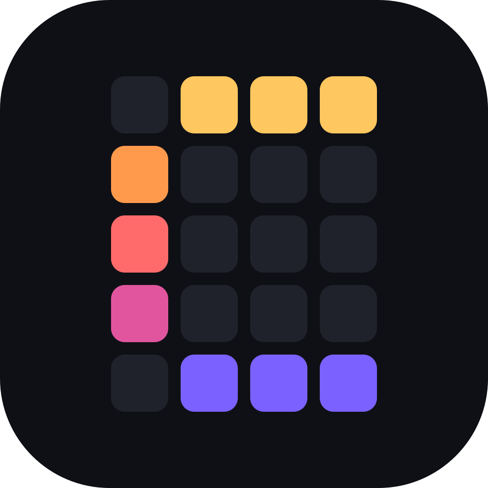
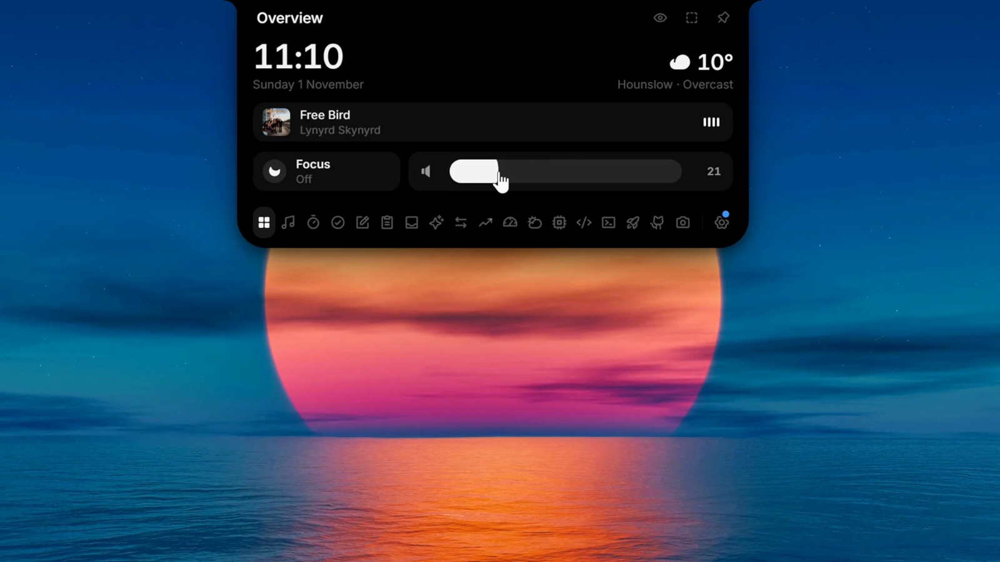
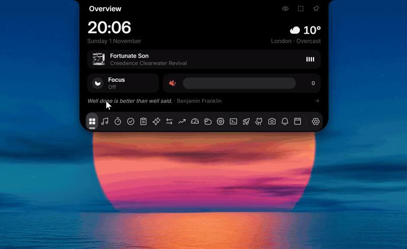

<p align="center">
  
</p>

<h1 align="center">Crest</h1>

<p align="center">
  <b>A Dynamic Island for the top of your Windows screen.</b>
</p>

<p align="center">
  <a href="LICENSE"></a>
  <a href="https://github.com/andrealo20/crest/releases/latest"></a>
  
  
  <a href="https://github.com/sponsors/andrealo20"></a>
</p>

<p align="center">
  <a href="https://github.com/andrealo20/crest/releases/latest"><b>Download</b></a>
  &nbsp;·&nbsp;
  <a href="#features"><b>Features</b></a>
  &nbsp;·&nbsp;
  <a href="#your-data-stays-on-your-pc"><b>Privacy</b></a>
  &nbsp;·&nbsp;
  <a href="https://github.com/andrealo20/crest/issues/new/choose"><b>Suggest an idea</b></a>
</p>

## What it is

Crest sits at the edge of your screen as a small notch (at the top unless you move it to another edge), stays out of the way until you need it, and opens on hover, click or **Ctrl + Alt + Space**.

Inside: music controls with a live equalizer and synced lyrics, a vault for passwords and 2FA codes, live weather, your Discord call, your portfolio across several brokers, an AI chat (Claude, ChatGPT and more) with your usage limits, clipboard history, a file shelf, screenshots and screen recording, a terminal, an app launcher, your GitHub activity, a file and unit converter, timers, to-dos with reminders, notes, a code scratchpad, a water reminder, live hardware stats with FPS for games, Windows notifications in the notch, themes, and privacy dots for mic, camera and screen recording.

Crest is free and open source under the GPL-3.0. It is a fork of [L4-Notchbar](https://github.com/Linux5Real/L4-Windows-NotchBar) 1.6.0.

<!--
  Screenshots and demo. Nothing here renders until the comment markers around this block are removed.

  1. Hero screenshot: save it as docs/media/hero.png (about 1600 px wide), then move this line out of the comment:
     <p align="center"></p>

  2. Demo: GitHub does not play a video stored in the repository from a README. Either drag docs/media/demo.mp4
     into README.md while editing it on github.com (GitHub uploads it and inserts a user-attachments link to paste here),
     or save a short loop as docs/media/demo.gif and move this line out of the comment:
     <p align="center"></p>
-->

## Features

### The closed notch and its row

Pick the closed look under **Settings → Display**.

- **Notch** hugs the top edge like a hardware notch.
- **Capsule** is a pill you can drag up and down to any height. It snaps to the screen edges and the taskbar.
- **Line** is a thin bar with a progress bar for the current song. It shows only the song's progress, and a finished timer.

Notch and capsule show a row of parts, centred and in the order you choose:

- the cover of what is playing, a running timer, your Discord call;
- AI quota rings (one colour per provider);
- song title (or the current lyric line);
- hardware readings: CPU, RAM and GPU, plus network, power, battery and temperature if you turn them on;
- equalizer, clock (with seconds if you like) and today's GitHub contributions.

Turn each part on or off and drag to reorder them in **Settings → Display**. When the parts do not fit, the row rotates through them like a carousel.

**Privacy dots** turn green when the microphone or camera is in use and red while the screen is being recorded, like on an iPhone.

### Notices

Notices appear over the row, one at a time:

- a running recording, with its time and pause and stop buttons, until it ends;
- a finished timer, until you dismiss it;
- a screenshot or recording just saved, for 4 seconds, with a thumbnail; click it to open the file;
- a status alert (see below);
- a live notice from Windows or `crest-notify`, for 6 seconds;
- a quota alert at 70% and 90%, for 5 seconds (it needs the AI quota rings turned on);
- a new song, for 4 seconds, while the title part is off;
- a due to-do, with buttons to snooze it 10 minutes or mark it done;
- the water reminder, with buttons to log a drink or wait for the next one.

A running recording outranks every other notice, so its stop button stays in reach.

Status alerts show briefly when you plug in or unplug the charger, when the battery reaches 20% and 10%, when the internet drops or comes back, and when Bluetooth headphones connect or disconnect. Turn each one off in **Settings → Display**.

### Music and lyrics

- **Now Playing** controls anything with a Windows media session (Spotify, browser players and so on) and shows cover, title, progress and a live equalizer.
- The equalizer is driven by the playing app's own audio, so a notification or a call doesn't move it (on Windows builds before 20348 it follows the whole output).
- Shuffle and repeat appear when the app offers them.
- With several players open, the name left of the controls picks one and pins it; Automatic follows whatever plays.
- **Synced lyrics** from LRCLIB: the microphone button opens them under the controls, scrolling along with the song. Click a line to jump there.
- In the closed notch the song title part can show the current line instead of the title (its **Lyrics** switch in **Settings → Display**).
- **Lyrics in the closed notch** shows only the cover and the line (plus a running timer or Discord call) while a song plays, with the notch growing and shrinking to each line.

### Overview, weather and Discord

- **Overview** is a small control center: time, weather, what is playing right now, Windows focus and a volume slider.
- **Weather** gives current conditions and a 7-day forecast through Open-Meteo. No API key needed.
- **Discord** shows your current voice call with speaking members and buttons for mute, deafen and hang up. In the closed notch, a green equalizer plays while someone talks.

### Productivity tools

- **Timer** with focus and break presets, custom durations, six alarm sounds and a running countdown in the closed notch. An expired timer stays visible until you dismiss it.
- **To-dos** and **notes** live on your machine and need no account. A to-do can have a due time; when it comes, an alarm sounds (unless you turn the sound off) and the to-do shows in the closed notch until you snooze it or mark it done.
- **Clipboard** keeps a history of text, links, images and files, with filters and previews. Password managers are excluded on purpose, and nothing is written to disk.
- **Shelf** is a parking spot for files. Drop them onto the notch or press Ctrl + V, then open, copy or reveal them later.
- **Scratchpad** is a code pad with syntax colouring for JavaScript, TypeScript, Rust and Python, or plain text. Each language keeps its own draft, saved as you type.
- **Water** logs what you drink against a daily goal (2 L unless you change it), with an hourly chart. Reminders are optional: every hour, or the interval you pick, between the times you set.
- **Converter** handles units, images (PNG, JPG, WebP, ICO, BMP, DDS), documents (PDF, DOCX, TXT, Markdown, HTML), spreadsheets (XLSX, CSV, JSON) and audio or video if ffmpeg is installed.

### Capture

- **Screenshots** of all screens, one screen or a region you drag, saved as PNG in *Pictures\Crest\Screenshots* and copied to the clipboard, optionally onto the Shelf too.
- **Recordings** of a screen or a window to MP4 in *Videos\Crest\Recordings*, at 30 or 60 fps, with system audio and the microphone if you want them.
- While it records, the closed notch shows the time with pause and stop buttons.
- Crest keeps itself out of its own screenshots and recordings; other apps that record or share the screen still see it.
- The tool lists what you took, with thumbnails and lengths; a deleted capture goes to the Recycle Bin.

### Terminal

- Runs PowerShell 7, Windows PowerShell or Command Prompt inside the notch, with a start folder and font size of your choice.
- The session can keep running while the notch is closed.

### Launcher and GitHub

- **Launcher** lists your pinned apps (detected AI apps such as Claude, ChatGPT and Cursor are pinned on first use) and starts them with a click. Any Start menu entry can be pinned.
- If you opt in, the first six also open with **Alt + 1** to **Alt + 6**, which then no longer reach other apps.
- **GitHub activity** shows the contribution calendar of a public username for the last 36 weeks, with the yearly total, today's count and your current and longest streak. A part in the closed notch shows today's count.
- It reads the public contribution page once an hour; a token without any rights is only needed if that page cannot be read.

### AI chat and usage

- **Ask** is a chat with Claude, ChatGPT, OpenRouter or any OpenAI-compatible endpoint, with streaming and adjustable reasoning effort.
- **AI usage** shows your subscription limits for Claude, ChatGPT, Antigravity, Cursor and the Z.ai coding plan, and credits and balances for OpenRouter and DeepSeek.
- It also shows the tokens and cost of Claude Code and Codex today and over 7 days, read from their local logs. A models page breaks tokens and cost down per model for today, 7 or 30 days.
- Cards can be reordered, renamed, added and removed.

### Hardware monitor

- **Hardware** shows live CPU, RAM, GPU, VRAM, network, power draw, battery, temperatures, ping, the busiest processes and your drives, with history that keeps recording while the notch is closed.
- Readings your PC cannot give (a battery on a desktop, a missing sensor) are left out.
- **Gaming mode** adds FPS to the readings in the closed notch, always or only while a fullscreen app runs. FPS works for DirectX, OpenGL and Vulkan games.
- Windows only allows FPS readings for members of the *Performance Log Users* group: click **Settings → Display → Unlock FPS** once, confirm the Windows prompt, then sign out and back in. A lock icon in the notch means this step is still missing.

### Portfolio

- Combines Trading 212, Kraken, Coinbase, Binance, Bitpanda, eToro, Interactive Brokers and holdings entered by hand in one base currency.
- Profit and loss per account and in total, and a history chart.
- The app only reads, it never trades or moves funds.

### Vault

Passwords and two-factor codes, one hover away and encrypted on your PC.

- **Passwords** with name and username or email. Copy either one with a click, show or edit the password, or let the generator create a strong one.
- **2FA codes** with a live countdown. Screenshot the QR code (Win + Shift + S) and press **Ctrl + V**, or type the key, then name it.
- **4-digit PIN** before anything secret is shown or copied, adjustable for passwords and 2FA separately in **Settings → Tools → Vault**. Five wrong tries lock it for 30 seconds, doubling from there.
- **Never in clipboard history.** Copies skip the Crest clipboard and Windows' Win + V history, and passwords and codes leave the clipboard after 30 seconds.
- **Local only**, encrypted with Windows DPAPI and bound to your Windows account. Forgot the PIN? **Reset vault** in settings deletes everything; there is no back door.
- **Windows Hello (optional):** unlock with face, fingerprint or Windows PIN instead of the vault PIN. Secrets are then additionally encrypted with a key from your PC's security chip, so even malware running as you can't read them without your confirmation.

The vault is off by default; turn it on under **Settings → Tools**.

### Themes

- Seven built-in panel themes (Dark, Light, One Dark Pro, GitHub Dark, GitHub Light, Dracula and Night Owl) under **Settings → Themes**.
- The editor changes background, foreground, accent and the warning colours with a colour picker and shows each change on the panel at once.
- Save the result as your own theme, export and import themes as JSON files, or switch between a day and a night theme by time.
- The closed notch stays black unless a theme opts in to colour it.

Details: [docs/themes.md](docs/themes.md).

### Live notices and crest-notify

- Turn on **Settings → Notices** and Windows notifications from any app show in the closed notch for 6 seconds, with the app's logo, name, title and text, and land on a **Notices** page in the open notch.
- Each app can be shown, muted (history only) or turned off.
- Presentation mode, a full-screen app, Windows focus or Do Not Disturb, and an optional daily quiet window keep them in the history without popping up.
- Scripts, builds and coding agents can send their own notices with `crest-notify`, including `crest-notify run -- <command>` for the exit code and duration.

Details, ready-made hooks for Claude Code and Codex, and how notifications are read: [docs/notices.md](docs/notices.md).

### Screen edges, window rules and panel size

- **Any screen edge.** **Screen edge** in **Settings → Display** hangs the notch and the line from the top, bottom, left or right edge, from the screen's edge or from the taskbar's. Dragging the closed notch towards another edge moves it there. The capsule stays on the top.
- On the left and right edges the parts stand in a column, and a notice shows as one icon: a finished timer (click to dismiss), a status alert, a live notice's app logo or a due to-do (click to open the To-dos).
- **Screen and app rules.** **Settings → Window** chooses what Crest does while a maximized window, a borderless full-screen app or an exclusive full-screen game covers its monitor: keep its look, turn into the line, or hide. It can also check the windows behind the one in front. Rules per app, picked from the running apps or typed, override these.
- **Panel size and scale.** Drag the open panel's sides, bottom or bottom corners to size each tool (double click resets), or pick Compact, Standard or Spacious for all of them. The whole notch can be shown at 100 % or 150 %.

### Shortcuts

- Opening and closing, hiding and showing Crest, and resizing the panel with the arrow keys each take a shortcut you record in **Settings → Window**.
- Crest tells you when another program or the launcher's Alt keys already use it.
- Opening Crest on purpose (shortcut, tray, a second launch) shows it even while a rule hides it, until it closes again.
- Right click on the notch opens the settings, and the mouse wheel switches tools.

### Portable build

- A zip that runs from any folder you can write to, with nothing installed and its data in a folder next to it. See [Install](#install).

## Install

**Microsoft Store.** Coming soon. Until then, use one of the downloads below.

**Installer.**

1. Download `Crest_x.y.z_x64-setup.exe` from the [latest release](https://github.com/andrealo20/crest/releases/latest).
2. Run it. No Node, Rust or admin rights needed; it installs for your user only.
3. The notch appears at the top of your screen and starts with Windows from then on.

The installer is not code-signed yet, so Windows SmartScreen may warn on first launch. Click **More info → Run anyway**.

**Portable zip.** Download Crest-x.y.z-Portable-x64.zip instead, unzip it anywhere you can write to and run Crest.exe. Nothing is installed: settings, notes and caches stay in a data folder next to it, crest-notify.exe comes along, and updates replace both in place after checking their signature. Start with Windows is off for a portable copy until you switch it on. API keys stay in the Windows Credential Manager of each PC. Details are in README-portable.txt inside the zip.

Crest keeps its settings and data apart from L4-Notchbar, so both can be installed at the same time.

**Requirements.** Windows 11 or Windows 10, 64-bit. Built and tested on Windows 11; Windows 10 should work but is untested. Crest uses WebView2; if it is missing, the installer fetches it automatically.

**Crash log.** If Crest crashes, panics and uncaught interface errors are appended to `crash.log` in `%LOCALAPPDATA%\io.github.andrealo20.crest\logs` (installer), or in `data\logs` next to Crest.exe (portable). Past 512 KB it is renamed to `crash.old.log` and a new one starts. The file stays on your PC; attach it to a bug report if you like.

## Using it

| Action | How |
| --- | --- |
| Open or close | Hover, click or **Ctrl + Alt + Space** (choose the trigger in settings) |
| Switch tools | Tool bar at the bottom of the open notch |
| Settings | Gear icon at the end of the tool bar, or **Settings …** in the tray menu |
| Tray icon | Left click opens the notch, right click shows the menu (open, settings, autostart, quit) |
| Move the notch | Drag it along its edge, closed or by its header; drag the closed notch towards another edge to move it there. "Reset to center" is in settings |
| Focus mode | Click the notch three times quickly. It turns half transparent and clicks pass through. Three more clicks bring it back |
| Add files | Drag them onto the notch, or paste with Ctrl + V |

## Settings

Settings are grouped into General, Display, Window, Tools, Timer, AI, Connections, Themes and Notices. There you can reorder (drag) or hide tools, pick the monitor and the screen edge, set what the notch does over full-screen and maximized windows, record shortcuts, and enable autostart. The interface is in English.

### Setting up the integrations

Every integration is optional. Tools you don't connect simply stay out of your way.

**Ask (AI chat).** Under **AI**, choose a provider (Claude, ChatGPT, OpenRouter or a custom endpoint) and paste your API key. For a custom endpoint, enter the base URL (usually ending in `/v1`) and a model ID. The reasoning effort is set there too.

**AI usage.** Nothing to enter. If you are signed in to Claude Code, the Codex CLI, the Antigravity CLI (`agy`) or Cursor on this PC, Crest reads their existing local login and shows your limits. For Antigravity it asks the CLI itself and never touches its login.

OpenRouter, DeepSeek and Z.ai need an API key, entered under **AI** once the card is switched on (OpenRouter uses the same key as Ask). Token cost is estimated at the API list price of each model; for models the built-in table does not know, click the cost on the models page and set a price by hand. With a subscription the figure is what the same tokens would cost on the API, not what you pay. After a rate limit (HTTP 429) a source pauses for 2 to 30 minutes, or as long as the service asks, and keeps showing its last reading.

**Portfolio.** Under **Connections** pick the base currency and set up each account with a key that can only read; each provider lists the exact rights to tick (for Trading 212: account data and portfolio; Kraken: Query Funds and Query Ledger Entries; Coinbase: an ECDSA key with View only; Binance: Enable Reading only; Bitpanda: Balances; eToro: a Read key; Interactive Brokers: a Flex Web Service token and an Activity Flex Query with Open Positions and Cash Report). Coins entered by hand are priced by CoinGecko; stocks and ETFs entered by hand use the price you type, since there is no free documented stock quote source. Degiro, Trade Republic and Scalable Capital have no official API and are not supported.

**Discord.** Discord only hands out voice permissions to your own application:

1. Create an application at [discord.com/developers](https://discord.com/developers).
2. Under OAuth2, copy the **Client ID** and **Client Secret** into **Connections**.
3. Under OAuth2, Redirects, add `http://localhost` and save. Without it Discord keeps asking for permission again.
4. Join a call. Discord asks you once to confirm.

**Weather.** Works out of the box with your approximate location (city level, from your IP), looked up at each start while the location is automatic and the weather shows (the Weather tool or Overview). The locate button in the tool looks it up again; pick a city by hand to stop the lookups.

## Your data stays on your PC

Crest has no account, no server of its own, no analytics and no tracking. Everything it stores (settings, to-dos, notes, timer presets) lives on your machine. The clipboard history is kept in memory only and never written to disk. The same policy, in short, is in [PRIVACY.md](PRIVACY.md).

- **Keys and secrets** are stored in the Windows Credential Manager under "Crest/…", never in a plain file, and they are never sent back to the interface. On the first start Crest copies keys it finds under "Notch/…" (where older versions and L4-Notchbar keep them). Those originals stay where they are: deleting a key in Crest does not remove them, so remove them in the Credential Manager if you no longer need them.
- **The vault** lives in one file encrypted with Windows DPAPI, readable only under your Windows account. The PIN is checked in the app's backend, not in the interface, and 2FA keys never leave the backend. With Windows Hello turned on, secrets are additionally sealed with AES-256-GCM under a TPM-backed Windows Hello key.

### What goes over the network, and when

Every request goes straight from your PC to the service named here, and nowhere else. On by default are the AI usage rings, the weather in Overview and the daily update check; everything else makes no requests until you set it up or turn it on.

- **AI usage** (the quota rings in the closed notch are on by default, with the Claude, ChatGPT and Antigravity cards): while the rings show or the AI usage tool is open, Crest asks the services you are signed in to on this PC, at most every 5 minutes for Claude and Antigravity and every 2 minutes for the others: api.anthropic.com with the Claude Code login, chatgpt.com with the Codex CLI login, cursor.com with the Cursor login, and openrouter.ai, api.deepseek.com and api.z.ai with the key you entered. For Antigravity it starts the `agy` CLI on your PC, which asks Google itself. A service you are not signed in to and have no key for gets no request. Token counts are read from local log files and never sent anywhere.
- **Ask** sends your messages to the provider you chose (api.anthropic.com, api.openai.com, openrouter.ai or your own endpoint), only when you send one.
- **Portfolio** asks each broker you set up (live.trading212.com or demo.trading212.com, api.kraken.com, api.coinbase.com, api.binance.com, api.public.bitpanda.com, public-api.etoro.com, ndcdyn.interactivebrokers.com), plus api.coingecko.com for coin prices and api.frankfurter.dev for the ECB exchange rates. Those two get only coin symbols and currency codes, no account data.
- **Weather** sends the place's coordinates to api.open-meteo.com for the forecast, and what you type to geocoding-api.open-meteo.com when you search a city. To find your approximate location it asks get.geojs.io, and ipwho.is if that fails, once per start while the location is automatic and the weather shows (Weather tool or Overview); a city you pick stops it.
- **Discord** talks to the Discord app on your PC, to discord.com for the sign-in, and loads the call members' avatars and the server icon from cdn.discordapp.com while you are in a call.
- **GitHub activity**, once you set a username, reads github.com's public contribution page for it once an hour while the tool or its closed-notch part shows, or api.github.com if you added a token.
- **Hardware** sends an ICMP ping to 1.1.1.1 every 2 seconds while the Hardware tool is open, for the ping reading.
- **Lyrics** come from LRCLIB (lrclib.net). Crest sends the title and artist of whatever is playing, with its length, and nothing else. It does so only while the lyrics panel is open or a lyrics option of the closed notch is on, and never for sessions without a known length or longer than 20 minutes (streams, mixes, podcasts). Answers are kept in a small cache on your PC, so a song is looked up once.
- **Live notices** (off by default) read other apps' Windows notifications through Windows' own notification listener, after you allow it. Crest learns that one arrived from Windows' push notification event log for your account, reads only that notification, and never changes, dismisses or opens anything. The history is kept in memory only and is gone when Crest quits. `crest-notify` talks to Crest over a local named pipe that only your Windows account can open and that refuses connections from other computers; nothing goes over the network.
- **Updates.** Once a day the app makes one anonymous request to this repository's release on github.com to check for a new version. If one exists, a second request fetches its changelog from raw.githubusercontent.com. No personal data is sent. If an update exists, a dot appears on the gear icon and **Settings → General → Updates** shows it. Nothing is downloaded until you click **Update now**; the app then installs the update and restarts. Every update is cryptographically signed and verified before it is installed. You can turn the daily check off in the same place.

## Build from source

Built with **Tauri 2, React 19, TypeScript, Motion and Tailwind 4**. The app uses WebView2 instead of bundling Chromium, which keeps the release build at a few megabytes. Animations stay smooth because the window itself never resizes. Only the content inside it moves.

Prerequisites:

- Node.js 24. Node 22 or newer builds the app; `npm test` runs the TypeScript test files directly, which needs Node 22.18 or later.
- Rust (stable).
- WebView2 (part of Windows 11; on Windows 10 the installer fetches it).
- On Windows, the Visual Studio Build Tools with the C++ workload and a Windows 11 SDK, required for linking.

```bash
npm install
npm run dev        # browser with a fake desktop, ?slow=4 slows animations for tuning
npm run tauri dev  # the real app, run it in PowerShell
npm test           # frontend tests
npm run typecheck  # before every commit
npm run i18n       # finds missing English strings (add --fix for TODO entries)
cd src-tauri && cargo test   # backend tests
```

In the browser, `?showcase` switches to English with curated demo data (music, Discord call, portfolio, chat).

To build a standalone executable:

```bash
npx tauri build --no-bundle   # result: src-tauri/target/release/crest.exe
```

Run Tauri and Cargo commands from PowerShell. In Git Bash, `/usr/bin/link` shadows the MSVC linker and the build fails.

### Releasing

Releases are built by GitHub Actions (`.github/workflows/release.yml`). Bump the version, commit and push:

```bash
npm run bump 0.2.0
git commit -am "Release 0.2.0"
git push
```

The workflow builds the signed installer and publishes release `v0.2.0` with the installer, its signature and `latest.json`, which installed apps use to offer the update. Pushes without a version bump don't create a release. The signing key lives in the repository secret `TAURI_SIGNING_PRIVATE_KEY`.

### Project layout

```
src/            React frontend: notch shape, tools, design tokens, i18n
src-tauri/      Rust backend: window, hit testing, tray and the Windows APIs
scripts/        Helper scripts such as the version bump and the i18n check
docs/           Longer guides, such as live notices and crest-notify
```

## Support the project

Crest is free, with no ads and no paid tier. If it is useful to you:

- [Sponsor it on GitHub Sponsors](https://github.com/sponsors/andrealo20). Donations are voluntary.
- Star the repository, so others can find it.
- [Report a bug or suggest an idea](https://github.com/andrealo20/crest/issues/new/choose).

## Contributing

Bug reports, ideas and pull requests are welcome. For anything larger than a small fix, open an issue first so we can agree on the approach. Before a pull request, run `npm run typecheck`, `npm test`, `npm run i18n` and `cargo test`, and keep interface text in English. Contributions are released under the GPL-3.0, like the rest of the project.

## Credits and licences

Crest is a modified version of [L4-Notchbar](https://github.com/Linux5Real/L4-Windows-NotchBar) by Linux5Real, forked from version 1.6.0 on 31 October 2026. The commit history lists every change since then.

- The Antigravity quota reader comes from an upstream pull request by [Fraustiz](https://github.com/Linux5Real/L4-Windows-NotchBar/pull/11).
- The LRCLIB lookup (exact match, search fallback by length, cleanup of video titles) follows an upstream pull request by mhmmdazizy ([L4-Notchbar PR #13](https://github.com/Linux5Real/L4-Windows-NotchBar/pull/13)).
- The layout of the collapsed row, the carousel timing, the capsule placement rules, the per-app audio capture, the way live notices learn of new Windows notifications from the event log, the screen-edge frame, the side column, the portable packaging, the window and app rules, the shortcut text and the panel sizes and scale are translated from [BrimDeck](https://github.com/MoFeng2223/BrimDeck) (Apache-2.0, license text in [licenses/BrimDeck-LICENSE](licenses/BrimDeck-LICENSE)).
- The panel themes, their readability correction and the day and night switch are translated from BrimDeck too ([docs/themes.md](docs/themes.md)). The One Dark Pro, GitHub, Dracula and Night Owl themes use the colours of those VS Code themes under the MIT License ([licenses/theme-palettes-MIT.txt](licenses/theme-palettes-MIT.txt)).
- The notch proportions were derived from [NotchDrop](https://github.com/Lakr233/NotchDrop) (MIT).
- The terminal uses [xterm.js](https://github.com/xtermjs/xterm.js) (MIT, [licenses/xterm-MIT.txt](licenses/xterm-MIT.txt)).
- The text is set in [Inter](https://github.com/rsms/inter) (SIL Open Font License 1.1, [licenses/Inter-OFL.txt](licenses/Inter-OFL.txt)), bundled through Fontsource.
- The icons are [Phosphor](https://github.com/phosphor-icons/react) (MIT, [licenses/Phosphor-MIT.txt](licenses/Phosphor-MIT.txt)).
- The design follows Apple's Dynamic Island and the macOS app OmniNotch. Crest is not affiliated with Apple or OmniNotch.

## License

[GPL-3.0](LICENSE). You may use, study, change and share this project, also commercially, but any version you distribute must stay open source under the same license and keep the copyright notices.

Crest is a fork of L4-Notchbar 1.6.0. The source code of every release, including the Microsoft Store builds, is in this repository: each release has a version tag that points to the exact code it was built from.
