

  

<h1 align="center">Crest</h1>

  <b>A Dynamic Island for the top of your Windows screen.</b>

  <a href="https://apps.microsoft.com/detail/9N2KXJ2924KS?referrer=appbadge&mode=full">
    <picture>
      <source media="(prefers-color-scheme: dark)" srcset="docs/media/store/get-it-from-microsoft-light.svg">
      
    </picture>
  </a>

  
  
  
  
  

  <a href="https://github.com/andrealo20/crest/releases/latest"><b>Download</b></a>
  &nbsp;·&nbsp;
  <a href="#features"><b>Features</b></a>
  &nbsp;·&nbsp;
  <a href="#your-data-stays-on-your-pc"><b>Privacy</b></a>
  &nbsp;·&nbsp;
  <a href="https://github.com/andrealo20/crest/issues/new/choose"><b>Suggest an idea</b></a>

https://github.com/user-attachments/assets/e466c24f-95a3-4804-ac29-833cfb46866f

## What it is

A notch at the edge of your Windows screen that opens on hover, click or **Ctrl + Alt + Space** and holds the tools you reach for all day. Free and open source.

## Features

 <b>The closed notch</b>: cover, timer, title or lyrics, AI quota, CPU, RAM, GPU, network, power, battery, temperature, clock and GitHub in one row, rotating when it doesn't fit. A notch, a capsule or a line, on any screen edge and in the size you choose, with a colour for each icon if you want one.

<table>
  <tr>
    <td width="50%" valign="top">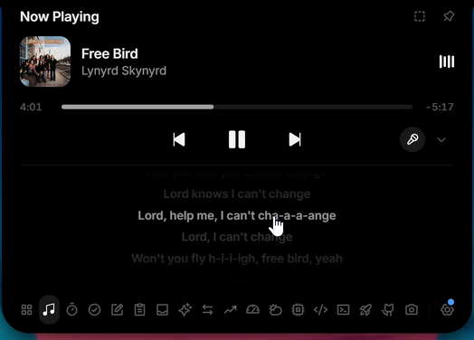 <b>Now Playing</b>: any player, with a live equalizer and synced lyrics</td>
    <td width="50%" valign="top">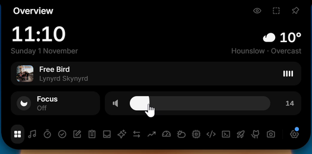 <b>Overview</b>: time, weather, the song playing, focus and volume</td>
  </tr>
  <tr>
    <td valign="top">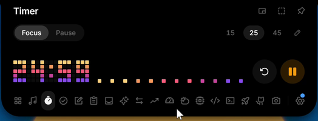 <b>Timer</b>: focus and break presets in big pixel digits</td>
    <td valign="top">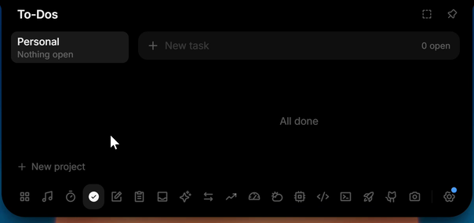 <b>To-dos</b>: projects, due times and reminders</td>
  </tr>
  <tr>
    <td valign="top">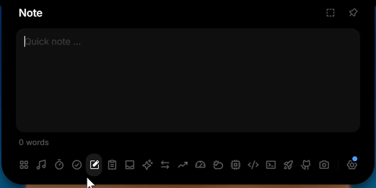 <b>Notes</b>: a quick note, saved as you type</td>
    <td valign="top">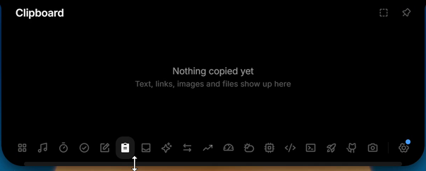 <b>Clipboard</b>: text, links, images and files, never written to disk</td>
  </tr>
  <tr>
    <td valign="top">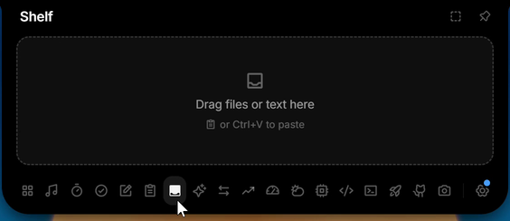 <b>Shelf</b>: a parking spot for files, dropped or pasted</td>
    <td valign="top">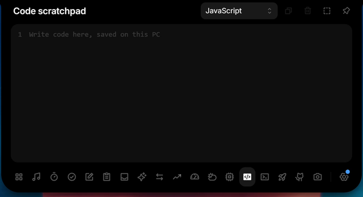 <b>Scratchpad</b>: code with syntax colouring, one draft per language</td>
  </tr>
  <tr>
    <td valign="top">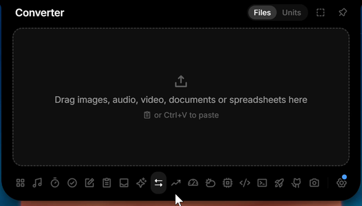 <b>Converter</b>: units, and currencies at the ECB rates</td>
    <td valign="top">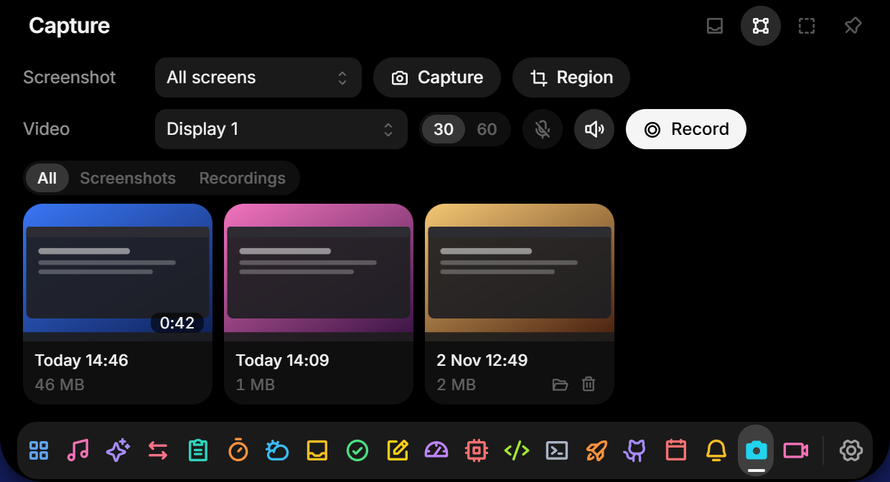 <b>Capture</b>: screenshots and recordings with system audio and mic</td>
  </tr>
  <tr>
    <td valign="top">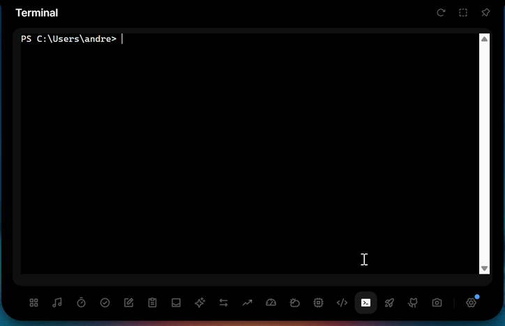 <b>Terminal</b>: PowerShell or Command Prompt inside the notch</td>
    <td valign="top">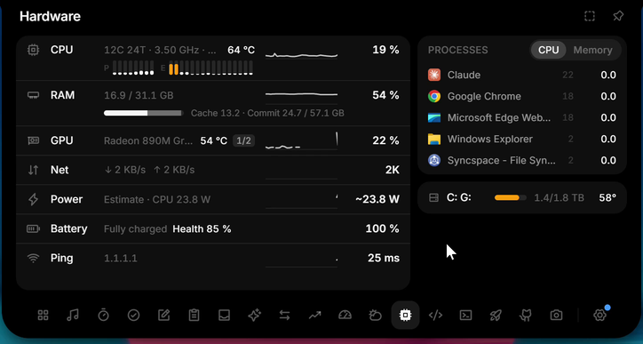 <b>Hardware</b>: CPU, GPU, RAM, network, power, temperatures and FPS</td>
  </tr>
  <tr>
    <td valign="top">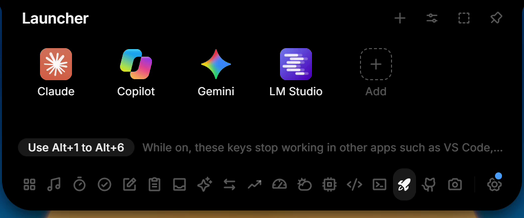 <b>Launcher</b>: your pinned apps, one click away</td>
    <td valign="top">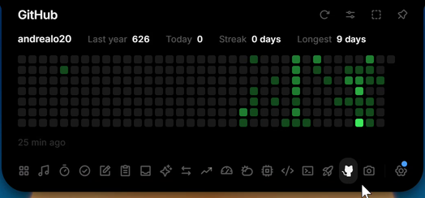 <b>GitHub</b>: contribution calendar, today's count and streaks</td>
  </tr>
  <tr>
    <td valign="top">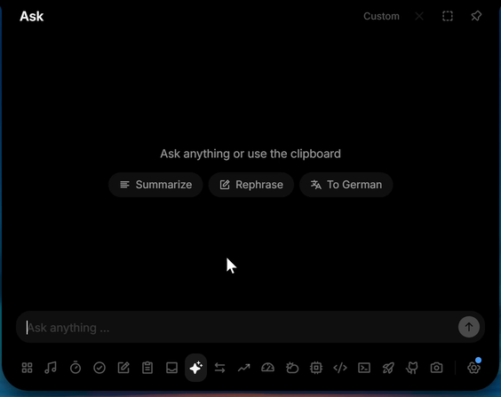 <b>Ask</b>: chat with the AI provider you choose, with your own key</td>
    <td valign="top">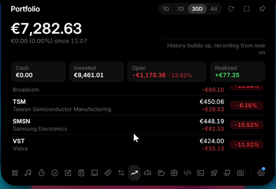 <b>Portfolio</b>: several brokers in one currency, read only</td>
  </tr>
  <tr>
    <td valign="top">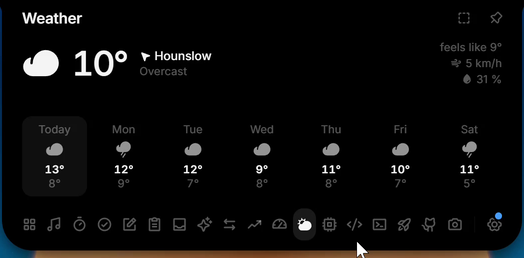 <b>Weather</b>: current conditions and a 7-day forecast</td>
    <td valign="top">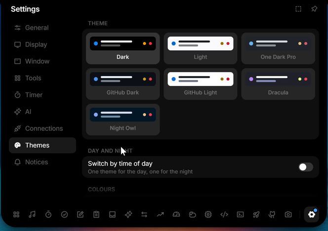 <b>Themes</b>: seven built in, an editor and a day and night switch</td>
  </tr>
  <tr>
    <td valign="top">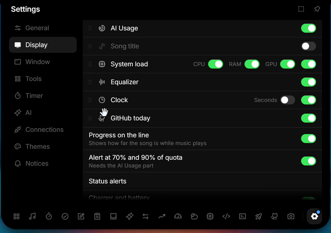 <b>The closed row</b>: pick and order what it shows</td>
    <td valign="top">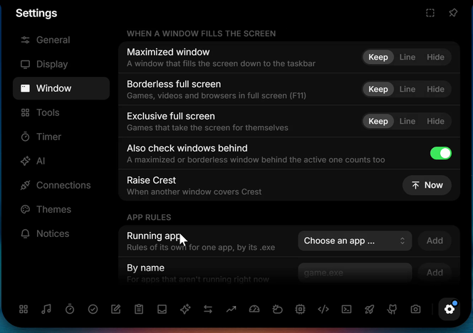 <b>Window rules</b>: keep, shrink to a line or hide over full-screen apps</td>
  </tr>
  <tr>
    <td valign="top">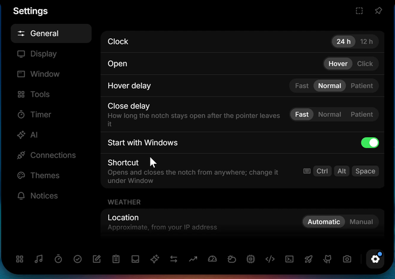 <b>General</b>: hover or click, delays, autostart and your shortcut</td>
    <td valign="top">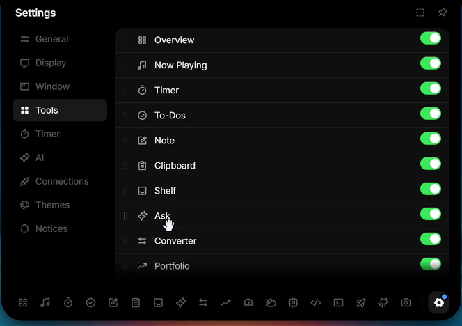 <b>Tools</b>: reorder, hide and tune every tool</td>
  </tr>
</table>

Also in the notch: a password and 2FA vault, Windows notifications with a history page, `crest-notify` for scripts and builds, status alerts with a volume and brightness HUD, your Discord call and privacy dots for the mic, camera and screen recording.

A short first-run setup picks a preset (Music, Productivity, AI or your own tools), the closed look and edge, and shows how to open the notch; Settings → General runs it again.

Every feature in detail, with setup steps for each integration: [docs/features.md](docs/features.md).

## Install

- **Microsoft Store:** [Crest Island](https://apps.microsoft.com/detail/9N2KXJ2924KS), signed by Microsoft and kept up to date by the Store.
- **Installer:** download `Crest_x.y.z_x64-setup.exe` from the [latest release](https://github.com/andrealo20/crest/releases/latest) and run it. It installs for your user only. The installer is not code-signed yet, so SmartScreen may warn on first launch: click **More info → Run anyway**.
- **Portable:** unzip `Crest-x.y.z-Portable-x64.zip` anywhere you can write to and run `Crest.exe`. Nothing is installed.

Windows 11 or Windows 10, 64-bit.

## Your data stays on your PC

No account, no analytics, no tracking. Settings and data stay on your machine, keys live in the Windows Credential Manager, and Crest only goes online for the services you turn on. What goes over the network, and when: [PRIVACY.md](PRIVACY.md).

## Support the project

Crest is free, with no ads and no paid tier. If it is useful to you, [sponsor it on GitHub Sponsors](https://github.com/sponsors/andrealo20), star the repository or [suggest an idea](https://github.com/andrealo20/crest/issues/new/choose).

Building from source and contributing: [CONTRIBUTING.md](CONTRIBUTING.md).

## Credits and licences

Crest is a modified version of [L4-Notchbar](https://github.com/Linux5Real/L4-Windows-NotchBar) by Linux5Real, forked from version 1.6.0 on 31 October 2026. The commit history lists every change since then.

- The Antigravity quota reader comes from an upstream pull request by [Fraustiz](https://github.com/Linux5Real/L4-Windows-NotchBar/pull/11).
- The LRCLIB lookup (exact match, search fallback by length, cleanup of video titles) follows an upstream pull request by mhmmdazizy ([L4-Notchbar PR #13](https://github.com/Linux5Real/L4-Windows-NotchBar/pull/13)).
- The layout of the collapsed row, the carousel timing, the capsule placement rules, the per-app audio capture, the way live notices learn of new Windows notifications from the event log, the screen-edge frame, the side column, the portable packaging, the window and app rules, the shortcut text and the panel sizes and scale are translated from [BrimDeck](https://github.com/MoFeng2223/BrimDeck) (Apache-2.0, license text in [licenses/BrimDeck-LICENSE](licenses/BrimDeck-LICENSE)).
- The panel themes, their readability correction and the day and night switch are translated from BrimDeck too ([docs/themes.md](docs/themes.md)). The One Dark Pro, GitHub, Dracula and Night Owl themes use the colours of those VS Code themes under the MIT License ([licenses/theme-palettes-MIT.txt](licenses/theme-palettes-MIT.txt)).
- Hiding the Windows volume and brightness indicator follows [Bloom](https://github.com/SehajveerSingh2005/bloom) (GPL-3.0, license text in [licenses/Bloom-LICENSE](licenses/Bloom-LICENSE)).
- The notch proportions were derived from [NotchDrop](https://github.com/Lakr233/NotchDrop) (MIT).
- The terminal uses [xterm.js](https://github.com/xtermjs/xterm.js) (MIT, [licenses/xterm-MIT.txt](licenses/xterm-MIT.txt)).
- The text is set in [Inter](https://github.com/rsms/inter) (SIL Open Font License 1.1, [licenses/Inter-OFL.txt](licenses/Inter-OFL.txt)), bundled through Fontsource.
- The icons are [Phosphor](https://github.com/phosphor-icons/react) (MIT, [licenses/Phosphor-MIT.txt](licenses/Phosphor-MIT.txt)).
- The design follows Apple's Dynamic Island and the macOS app OmniNotch. Crest is not affiliated with Apple or OmniNotch.
- Crest is an independent app by Andrea Loroni. It is not made, sponsored or endorsed by Microsoft.

## License

[GPL-3.0](LICENSE). You may use, study, change and share this project, also commercially, but any version you distribute must stay open source under the same license and keep the copyright notices.

Crest is a fork of L4-Notchbar 1.6.0. The source code of every release, including the Microsoft Store builds, is in this repository: each release has a version tag that points to the exact code it was built from.
