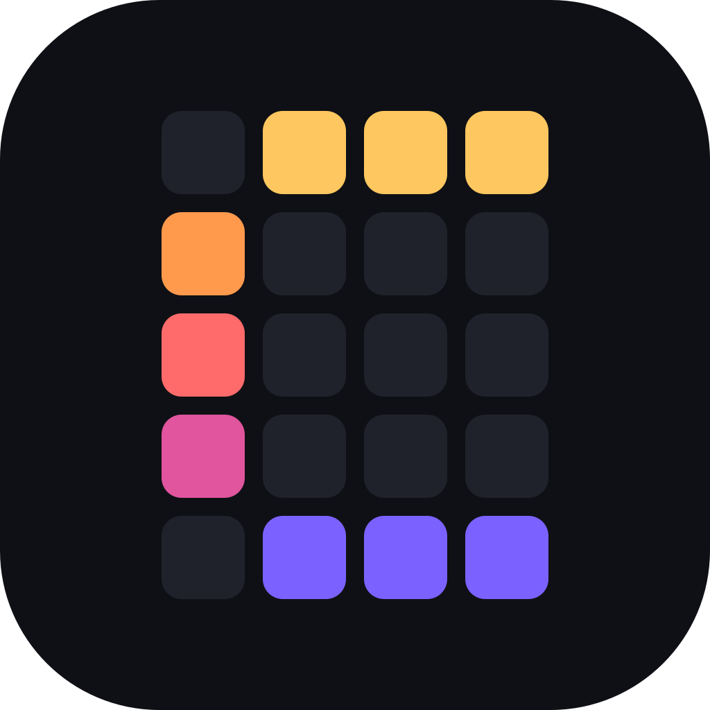
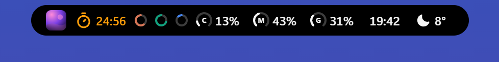
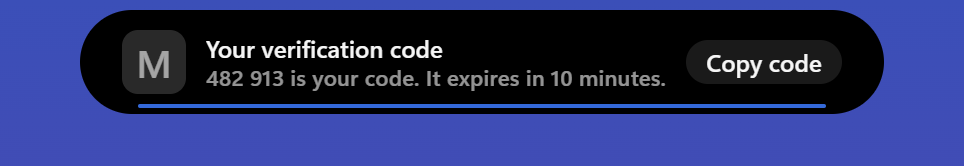
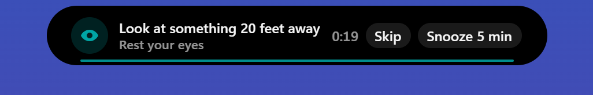

  

<h1 align="center">Crest</h1>

  <b>屏幕顶部的灵动岛，支持 Windows 和 macOS。</b>

  
  

  
  
  
  
  

  

  <a href="https://github.com/andrealo20/crest/releases/latest"><b>下载</b></a>
  &nbsp;·&nbsp;
  <a href="#功能"><b>功能</b></a>
  &nbsp;·&nbsp;
  <a href="#数据只留在你的电脑上"><b>隐私</b></a>
  &nbsp;·&nbsp;
  <a href="https://github.com/andrealo20/crest/issues/new/choose"><b>提建议</b></a>

  

https://github.com/user-attachments/assets/f3a34516-0d47-4f0c-a10f-25e95cc2cf64

## 这是什么

Crest 是 Windows 或 Mac 屏幕边缘的一个刘海，悬停、点击或按 **Ctrl + Alt + Space** 即可展开，里面放着你每天都要用的工具：大约三十个，每个都可以随意开关。免费、开源，无需账号，也不用付费。

上面的视频用不到两分钟展示了它们，[项目主页上的演示](https://andrealo20.github.io/crest/)让你在安装之前就能在浏览器里试用每一个工具。

收起时，Crest 只是一行：歌曲、正在运行的计时器、你的 AI 额度、CPU、内存和 GPU、网络、电池、时钟、天气、下一个会议。有事发生时，它会变成一张卡片停留几秒，然后恢复原样。

   
   
  
  

播放歌曲时，它可以用当前歌词代替歌名。AI 代理要运行命令前它会先问你，AI 额度快用完时会提醒你，下一个会议的通话一键就能加入。耳机、音量、麦克风、充电器和结束的计时器也都会短暂出现。

   
   
  
   
  
  
   
  
  

## 功能

下面的每个工具都在同一个刘海里。在 **设置 → 工具** 中选择你要的工具，拖动排成你喜欢的顺序，其余的不会打扰你。完整指南以及每项集成的设置步骤见 [docs/features.md](docs/features.md)（英文）。

### 收起的刘海

- **三种样式**：贴住屏幕边缘的刘海、可以拖到任意高度的胶囊，或显示歌曲进度的细线。可放在上、下、左、右任一边缘，大小由你决定。
- **这一行**按你选择的顺序显示你挑选的部分，放不下时轮流显示：封面、计时器、歌名或当前歌词、AI 额度环、CPU、内存、GPU、网络、功耗、电池、温度、时钟、GitHub、天气、下一个日程、下载，以及你自己的脚本设置的部分。
- **通知**会短暂占用这一行：计时结束、待办到期、会议即将开始、刚保存的下载或截图、额度提醒、充电器、蓝牙、网络、大写锁定、音量和亮度。
- **隐私圆点**在麦克风或摄像头使用时变绿，屏幕被录制时变红。
- **宠物**住在刘海旁边的小窝里（如果你想要）：随音乐跳舞，CPU 越忙跑得越快。

### 音乐

- **正在播放**可以控制任何支持 Windows 媒体会话的播放器，显示封面、进度和实时均衡器。
- **同步歌词**来自 LRCLIB、酷狗和网易云音乐，来源按字计时时逐字高亮，收起的刘海里也能显示。
- **翻译和罗马音**：使用来源自带的翻译，或用 Firefox 使用的离线模型在你的电脑上翻译成你选择的语言。日语、中文和韩语可以显示拉丁字母。
- **Discord**：你的语音通话、正在说话的人，以及静音、拒听和挂断按钮。

### 时间与专注

- **计时器**带专注和休息预设、六种提示音、专注时的背景音，以及十几种样式，从像素数字到翻页时钟。
- **世界时钟**最多 12 个城市，拖动滑块可把时间前后移动一天，并显示日出、日落、黄金时刻和月相。
- **休息提醒**：每 20 分钟提醒你休息眼睛，每小时提醒你真正休息一下，按你实际使用电脑的时间计算。演示、全屏应用和勿扰模式期间会等待。
- **习惯**显示五周的打卡圆点，偶尔漏掉一天也不会中断连续记录。
- **日历**来自 ICS 链接（Google、Outlook、iCloud）或 CalDAV，每个日程开始前提醒，在线会议有加入按钮。
- **喝水**按每日目标记录，在你设定的时间段内提醒。

### 写作与文件

- **待办**带项目、截止时间和提醒。输入 "call Marco tomorrow 9am"，任务就会带上时间（支持英语和意大利语）。
- **笔记**边写边保存，**代码草稿本**带语法高亮。
- **剪贴板**保存文本、链接、图片和文件的历史，从不写入磁盘。小标签可以解码 JWT、Unix 时间戳、Base64、JSON 或满是跟踪参数的链接。
- **暂存架**：把文件拖到刘海上暂存；**发送到手机**：扫描二维码，手机就能通过你自己的网络从电脑下载这些文件。
- **提词器**按你设定的速度滚动讲稿，还有镜像模式。

### 日常工具

- **概览**：时间、天气、正在播放的歌曲、专注、保持唤醒、音量、亮度，以及 Wi-Fi、蓝牙、深色主题和麦克风的快捷开关。
- **计算器**：笔记本式计算器，能识别单位、日期、百分比、货币和变量。
- **转换器**用于单位换算，货币按欧洲中央银行的汇率换算。
- **取色**：从屏幕任意位置取色，复制为 HEX、RGB、HSL 或 OKLCH，检查对比度并查看配色方案。
- **天气**：当前天气、逐小时和一周预报，数据来自 Open-Meteo。
- **投资组合**：把多个券商的资产换算成一种货币显示，只读。

### 开发者工具

- **终端**：刘海里的 PowerShell 或命令提示符。
- **硬件**：CPU、GPU、内存、网络、功耗、温度、最忙的进程和游戏帧率，还有电脑正在监听的端口以及对应的程序。
- **AI 用量**：Claude、ChatGPT、Antigravity、Cursor 等的额度，附带一行预测每项额度的走向，额度重置时可选择通知你。
- **提问**：用你自己的密钥与你选择的 AI 服务对话。
- **Agents**：电脑上正在运行的 Claude Code 会话、每个会话在等什么，以及恢复它的命令。
- **GitHub** 贡献日历和连续天数，以及固定应用的**启动器**。
- **crest-notify** 让脚本和构建发送通知、用按钮提问，或在收起的一行里放入自己的部分。

### 截图与录制

- **截图**可截取所有屏幕、单个屏幕或一个区域，**录屏**可带系统声音和麦克风。
- **录音机**只录声音，来自麦克风、系统声音或两者。
- **摄像头**在通话前当镜子用；**屏幕查找**识别所有屏幕上的文字并进行搜索。

### 通知与隐私

- **Windows 通知**显示在刘海里，带历史页面；通知里有一次性验证码时会出现**复制验证码**按钮。可以关闭 Windows 自己的横幅，让每条通知只出现一次。
- **保险库**保存密码和两步验证码，用 PIN 或 Windows Hello 保护，从不进入剪贴板历史。
- **演示模式**在你共享屏幕时隐藏剪贴板、余额、保险库和你的截图录屏；**在屏幕共享中隐藏 Crest** 让 Teams、Zoom、Discord 和 OBS 都看不到任何 Crest 窗口。

### 个性化

- **主题**：十五个内置主题、主题编辑器、十六种字体、彩色图标和昼夜切换。
- 全屏应用和游戏的**窗口规则**，可放在任意**显示器**或所有显示器上，每个面板的大小都可以调整。
- **11 种语言**：英语、简体中文、西班牙语、印地语、从右到左的阿拉伯语、法语、葡萄牙语、俄语、日语、德语和意大利语。
- **插件**：用 HTML、CSS 和 JavaScript 编写你自己的工具，在沙盒中运行（[docs/plugins.md](docs/plugins.md)）。

每个版本的变化见[发布说明](docs/releases)（英文）。

## 安装

- **Microsoft Store：** [Crest Island](https://apps.microsoft.com/detail/9N2KXJ2924KS)，由 Microsoft 签名，并由应用商店自动更新。
- **安装程序：** 从[最新版本](https://github.com/andrealo20/crest/releases/latest)下载 `Crest_x.y.z_x64-setup.exe`（Windows on ARM 电脑请下载 `Crest_x.y.z_arm64-setup.exe`）并运行。它只为当前用户安装。安装程序暂未进行代码签名，首次运行时 SmartScreen 可能会提示：点击 **更多信息 → 仍要运行**。
- **便携版：** 把 `Crest-x.y.z-Portable-x64.zip`（或 `-Portable-arm64.zip`）解压到任意可写的位置，运行 `Crest.exe`。不会安装任何东西。
- **Mac（预览版）：** Apple 芯片请下载 `Crest_x.y.z_aarch64.dmg`，Intel 请下载 `Crest_x.y.z_x64.dmg`，然后把 Crest 拖到“应用程序”文件夹。应用暂未经过公证，首次打开时 macOS 会拒绝运行：请打开 **系统设置 → 隐私与安全性 → 仍要打开**。文件架、硬件、Discord、保险库、终端、启动器、通知、录制、录音机和摄像头目前只支持 Windows，在 Mac 上不会显示，“在屏幕上查找”也没有快捷键。

每个版本都附带 `SHA256SUMS` 文件，列出每个下载文件的 SHA-256，可以用 `sha256sum -c SHA256SUMS --ignore-missing` 或 `Get-FileHash` 校验。

需要 Windows 11 或 Windows 10，64 位（x64 或 ARM64），或 macOS 12 及更高版本，Apple 芯片或 Intel（预览版）。

## 数据只留在你的电脑上

不需要账户，没有统计分析，没有跟踪。设置和数据保存在你的电脑上，密钥存放在 Windows 凭据管理器里（Mac 上是钥匙串），Crest 只为你开启的服务联网。哪些内容会经过网络、什么时候：[PRIVACY.md](PRIVACY.md)（英文）。

## 支持这个项目

Crest 免费，没有广告，也没有付费版本。如果它对你有用，可以[在 GitHub Sponsors 上赞助](https://github.com/sponsors/andrealo20)、给仓库加星，或者[提个建议](https://github.com/andrealo20/crest/issues/new/choose)。

从源码构建和参与贡献：[CONTRIBUTING.md](CONTRIBUTING.md)（英文）。

## 致谢和许可

Crest 是 Linux5Real 的 [L4-Notchbar](https://github.com/Linux5Real/L4-Windows-NotchBar) 的修改版本，于 2026 年 10 月 31 日从 1.6.0 版本分叉。之后的每一处改动都记录在提交历史里。第三方代码和资源的完整来源与许可证列在[英文 README](README.md#credits-and-licences) 中。

Crest 是 Andrea Loroni 的独立应用，与 Apple、OmniNotch 和 Microsoft 均无关联，也未获其赞助或认可。

## 许可证

[GPL-3.0](LICENSE)。你可以使用、研究、修改和分享这个项目，包括商业用途，但你分发的任何版本都必须以相同的许可证保持开源，并保留版权声明。

Crest 是 L4-Notchbar 1.6.0 的分叉。每个版本（包括 Microsoft Store 版本）的源代码都在这个仓库里：每个版本都有一个版本标签，指向构建它的确切代码。

## Star 历史

<a href="https://www.star-history.com/#andrealo20/crest&Date">
  <picture>
    <source media="(prefers-color-scheme: dark)" srcset="https://api.star-history.com/svg?repos=andrealo20/crest&type=Date&theme=dark" />
    <source media="(prefers-color-scheme: light)" srcset="https://api.star-history.com/svg?repos=andrealo20/crest&type=Date" />
    
  </picture>
</a>
