# Crest features

Everything Crest does, tool by tool. The short version with pictures is in the [README](../README.md).

## First-run setup

- On a new install the open notch starts with a short setup in three steps. **Skip** ends it at any step, and **Settings → General → Setup** runs it again.
- Step 1 picks a preset, which switches tools and parts of the closed row on and off. Overview stays on in each.
  - **Music:** Now Playing and Timer; the closed row shows the song title with the current lyric line, the equalizer and the timer.
  - **Productivity:** Timer, To-dos, Notes, Clipboard, Shelf, Converter and Weather; the row shows the timer and the equalizer.
  - **AI:** Ask, AI Usage and Terminal; the row shows the quota rings and the equalizer.
  - **Custom:** keeps what was there when the setup started (the defaults on a new install) and lets you tick tools one by one. Picking it after another preset undoes that preset.
- Step 2 picks the closed look (notch, capsule or line) and the screen edge.
- Step 3 shows the open shortcut and whether the notch opens on hover or on click.
- Updating from an earlier version never shows it: it only starts by itself when no settings were saved before.

## The closed notch and its row

Pick the closed look under **Settings → Display**.

- **Notch** hugs the top edge like a hardware notch.
- **Capsule** is a pill you can drag up and down to any height. It snaps to the screen edges and the taskbar.
- **Line** is a thin bar with a progress bar for the current song. It shows only the song's progress, and a finished timer.

Notch and capsule show a row of parts, centred and in the order you choose:

- the cover of what is playing, a running timer, your Discord call;
- AI quota rings, one colour per provider: the weekly or other longer limit outside, the 5-hour session in a thinner ring inside;
- song title (or the current lyric line);
- hardware readings: CPU, RAM and GPU, plus network, power, battery and temperature if you turn them on;
- equalizer, clock (with seconds and the date if you like), today's GitHub contributions, today's weather and your next calendar event;
- parts your scripts set with `crest-notify part`: an icon, a short text and a progress bar, which can open a tool or plugin on click;
- downloads in progress, while a browser is downloading something.

Turn each part on or off and drag to reorder them in **Settings → Display**. When the parts do not fit, the row rotates through them like a carousel.

A click on a part opens its tool: the readings open Hardware, the AI rings AI Usage, the cover, title and equalizer the music, the timer and the clock the Timer, the next event the Calendar, the weather the Weather tool, script parts Notices and downloads the Shelf. With **Open: Hover** the part under the pointer when the notch opens decides the same way, unless **Hovering a part opens its tool** is off (**Settings → General**, under Open). Anywhere else, or when that tool is off, the notch opens as usual.

**Adjust on the notch**, next to the size in **Settings → Display**, puts the closed notch, capsule or line in a resize mode: drag its ends to change the width (both sides move) and its far side to change the height, double-click a grip for the default, and finish with **Done** or Esc. It neither opens nor moves meanwhile, and the sliders in the settings keep working too.

**Focus mode with three clicks** (off by default, in **Settings → Display**) puts the notch aside without closing Crest. With it on, three quick clicks on the closed notch make it half transparent, or a thin line at the edge (**Focus look**; with the line as the closed look it stays the line, dimmed), and clicks pass through to the app below, to a browser's tabs at the very top for example. Three more clicks bring it back, and so do opening Crest with a shortcut or from the tray, turning the switch off and restarting Crest: focus mode is never saved. Meanwhile breaks wait, notices only go to the history and status alerts are skipped. In the half transparent look a finished timer, a due reminder, a question or the recording still come up as a card, and a click on the card opens the notch, which ends focus mode. With **Hide the Windows indicator** on, Windows' own volume and brightness indicator comes back until focus mode ends.

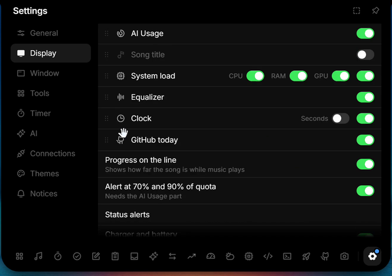

A small cup at the end of the row means keep awake is on (see Overview).

**Pet** (off by default, under **Settings → Display**) puts a small animal in a nest beside the closed notch: a black cat, a black cocker spaniel, a monkey, a sloth, a samurai, a robot, a flame or a zombie. It dances while music plays, runs faster the busier the CPU is, waves when the pointer is on the notch, reacts to a notice, cheers when something is finished (a download, a capture, a ticked to-do) and falls asleep when nothing happens. You set its size, independent of the notch's, and the side of the notch it sits on.
**Downloads** (on by default) shows while a browser downloads into your Downloads folder: a download icon, the size so far and the speed averaged over the last 3 seconds, like "124 MB · 8.2 MB/s", with the count in front when there are several. Browsers give no reliable total size, so there is no percentage. Crest spots the partial files browsers write (`.crdownload` for Chrome and Edge, `.part` for Firefox, `.download` and `.partial`) through Windows' change notifications for that folder, not its subfolders, and reads their sizes once a second only while one exists. When a download finishes, a notice says "Downloaded report.pdf" with **Show in folder** and **Add to Shelf**; a cancelled one just disappears. The notice stays quiet during the notices' quiet hours and in presentation mode, and has its own switch in **Settings → Display**. With both the part and the notice off, Crest stops watching the folder.

**Privacy dots** turn green when the microphone or camera is in use and red while the screen is being recorded, like on an iPhone. On Windows the red dot, and the presentation mode that can turn on with it, only see Windows' own capture tools (Snipping Tool, Click to Do) and Store apps: Windows keeps no record when a desktop app such as OBS, Zoom, Discord or a browser records or shares the screen. To keep Crest out of every recording, turn on **Hide Crest from screen sharing and recordings**.

## Notices

Notices appear over the row, one at a time:

- a running recording, with its time and pause and stop buttons, until it ends;
- a finished timer, until you dismiss it;
- a question from `crest-notify ask`, with a button per option, until you answer it or its time runs out (also on the idle line);
- a screenshot or recording just saved, for 4 seconds, with a thumbnail; click it to open the file;
- a finished download, for 6 seconds, with buttons to show it in its folder or add it to the Shelf;
- a status alert (see below);
- a live notice from Windows or `crest-notify`, for 6 seconds;
- a quota alert at 70% and 90%, for 5 seconds (it needs the AI quota rings turned on);
- a limit that has reset, for 5 seconds, when you turn that on in **Settings → AI** (it needs the AI quota rings too);
- a new song, for 4 seconds, while the title part is off;
- a calendar event about to start, 5 or 10 minutes before, until it starts or you dismiss it;
- a due to-do, with buttons to snooze it 10 minutes or mark it done;
- a break reminder, with the time left and buttons to skip it or snooze it 5 minutes, until its time is up (see Break reminders);
- the water reminder, with buttons to log a drink or wait for the next one.

A running recording outranks every other notice, so its stop button stays in reach.

Most of them are cards: the icon in a circle tinted with the notice's colour (a live notice from an app keeps its logo), a title, a line of text, buttons on the right and a line of the same colour along the bottom edge. The notch grows for a card and shrinks back when it goes.

Status alerts show briefly when you plug in or unplug the charger, when the battery reaches 20% and 10%, when the internet drops or comes back, and when a paired Bluetooth device (headphones, mouse, keyboard, controller and so on) connects or disconnects. "Charged" comes when charging stops on the charger at 80% or more (a full battery, or a charge limit), once a minute has passed since you plugged in and once per charge. **Energy saver and power mode** says when Energy saver turns on or off and when you pick another power mode (Best power efficiency, Balanced, Best performance); game mode coming and going, and a mode that changes with the charger, show nothing. **Airplane mode** says when it turns on or off, and the "Offline" that follows it is left out. **Output device** names the speakers or headphones Windows moves the sound to, with an icon for headphones, speakers or a monitor's speakers; a switch made in Crest's Overview shows nothing, and Bluetooth headphones that just connected show their own alert, with the battery. **Monitors** says when a monitor is connected or disconnected, with its refresh rate ("DELL U2720Q · 60 Hz"), once the changes a dock or a cable brings have been quiet for 2 seconds; a monitor that stays at another refresh rate shows it too. **Do not disturb** says when Do not disturb or a focus session turns on or off; Crest reads it twice a second while the alert is on, not over a fullscreen app (Windows can turn it on there by itself), and a switch made in Overview shows nothing. The microphone alert says "Microphone muted" and "Microphone on" when the shortcut (see Overview), a key on the laptop, Windows' settings or another app mutes or unmutes the default microphone; Overview's own switch shows nothing. **Copy** (off by default) says what you just copied, "Text copied", "Link copied", "Image copied" or "3 files copied", with the Clipboard tool's icon for it in teal, never the copied text itself; it needs the Clipboard tool, which is what watches the clipboard, and copies made in Crest or kept private by a password manager show nothing. Turn each one off in **Settings → Display**. For Bluetooth, Crest reads the paired devices from the list Windows keeps of them and never searches for devices, which on some PCs breaks Bluetooth audio up.

The volume and brightness HUD is a status alert too: when the volume or mute changes (keys, the mixer, any app) or the brightness changes, the closed notch shows an icon, a level bar and the percent for a moment, also on the line style, which opens for it. The icon is blue for the volume and yellow for the brightness, and Caps Lock switched on shows a red padlock; the bar and the text stay white. The other alerts colour their icon too (the output blue, Do not disturb violet, Energy saver and a charged battery green, airplane mode orange, a monitor indigo), and over glass every icon is white like the text, since no colour stays readable over every backdrop there. A status alert keeps its own size whatever the notch's: the shape is just large enough for its icon, bar and text, the notch springs to it and back, and a changing icon swaps in place. With Glass and its **Status alerts** switch on (Settings → Themes, on by default) it is clear glass like the tool bar, without frost, over a live copy of the screen that runs for it, and a few seconds after, even with "Also the closed notch and capsule" off (Windows 11 24H2 or later on x64, not in the Microsoft Store version); its first moment can be black until the copy comes, and over a full-screen app or while Crest is hidden it stays black, since the glass is off there. Changes made in Crest itself do not show it. The built-in screen reports its brightness at once; external monitors are read over DDC/CI every 2 seconds while the Brightness alert is on, and only those that support it. **Hide the Windows indicator** (off by default, needs Volume and Brightness on) keeps the Windows volume and brightness flyout invisible while Crest runs and while its HUD can show (not over a fullscreen app, not in focus mode, and not while a window rule or the hide shortcut hides Crest). Windows gets it back when you turn the option off or quit Crest, and a small helper process restores it if Crest crashes or is ended from Task Manager. **Show everywhere** (off by default) shows the indicators (volume, brightness, Caps Lock, Num Lock, Insert, the microphone and Copy) over full-screen apps and while a window rule or the hide shortcut hides Crest too, though not in focus mode: the notch comes out for the moment of the indicator without taking the focus or the pointer, and goes again. With Hide the Windows indicator on, Windows' own then never shows, except in focus mode. A game in exclusive full screen lets no window draw over it, Crest's included.

Caps Lock and Num Lock show the same way: switching either key says "Caps Lock on" or "Num Lock off" with its icon for a moment, also on the line style. Crest reads both keys every 150 ms while the **Caps Lock and Num Lock** alert is on (the default) and stops when you turn it off; it uses no keyboard hook, and the state at start never alerts. The **Insert key** alert (off by default, Windows only) says "Insert" when you press that key alone, read the same way; it never says on or off, because each program keeps its own overtype state, and shortcuts such as Shift+Insert show nothing.

## Music and lyrics

- **Now Playing** controls anything with a Windows media session (Spotify, browser players and so on) and shows cover, title, progress and a live equalizer.
- The equalizer is driven by the playing app's own audio, so a notification or a call doesn't move it (on Windows builds before 20348 it follows the whole output).
- **Cover as background**: the button at the top right of the Music tool (or **Settings → Music**) puts the album cover, blurred and darkened, behind the whole panel; the text stays light on any theme. The cover itself grows as you make the Music panel taller, from 56 up to 140 px, and opening the lyrics adds room below the size you chose, so the panel can still be resized while they are open.
- **Equalizer style** (Bars, Spectrum with 12 thin bars, or Wave) and **Progress bar** (Line, or Wavy, which moves while a song plays and goes flat on pause) in **Settings → Display → Music** change the Music tool; the closed row keeps its four bars.
- Shuffle and repeat appear when the app offers them.
- The mixer, opened next to the playback controls, lists every app that plays sound, with its own volume slider and mute, like the Windows volume mixer.
- With several players open, the name left of the controls picks one and pins it; Automatic follows whatever plays.
- **Synced lyrics**: the microphone button opens them under the controls, scrolling along with the song. Click a line to jump there.
- **Lyrics sources** in **Settings → Display → Lyrics**, asked from top to bottom until one has the song: LRCLIB (open community database, on by default), Kugou and NetEase Cloud Music (unofficial APIs without an account, off by default). The arrow moves a source up.
- **Word by word**: when the source times each word (Kugou mostly does), the sung line lights up word by word; otherwise it lights up a line at a time.
- **Translation**: a small line under each lyric line when the source has one (Kugou and NetEase often do for Chinese, Japanese and Korean songs). **Translate offline** translates songs on your PC instead, into Crest's language or the one picked under **Translate into**, with the models Mozilla made for Firefox's page translation. Pick the languages to translate from under Settings → Music: each downloads a model of 40 to 70 MB once, plus one from English into your language. Crest recognises the language of each song by itself; nothing about the song leaves the PC. It is machine translation, so poetic lines can come out literal. The engine and the models are Mozilla's, under the MPL 2.0.
- **Romanisation** (off by default): Japanese, Chinese and Korean in Latin letters under each line, from the source when it has them, otherwise made on the PC. Korean follows the Revised Romanization, Chinese is pinyin with tone marks, Japanese kana use Hepburn. Kanji need the reading dictionary (JMdict common words, a 1.4 MB download from GitHub, about 0.7 MB on disk, removable); its readings are a dictionary's guess and can differ from what is sung. Without it only kana are romanised.
- In the closed notch the song title part can show the current line instead of the title (its **Lyrics** switch in **Settings → Display**). A paused song shows its title again. A line too long for its room scrolls once and stays at its end until the next line comes. A title too long for its part scrolls three times and rests at its start; **Keep scrolling**, beside Lyrics, keeps it going while the song plays.
- **Lyrics in the closed notch** shows only the cover and the line (plus a running timer or Discord call) while a song plays, with the notch growing and shrinking to each line. A pause in the singing shorter than 10 seconds keeps the last line on screen; a longer one brings back the usual row until the singing starts again.

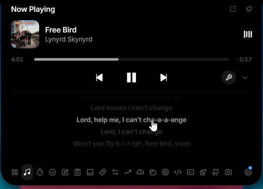

## Overview, weather and Discord

- **Overview** is a small control center: time, weather, what is playing right now (a song with play/pause and next buttons), Windows focus, keep awake and a volume slider. With more than one playback device, the button at the end of the slider lists them and makes the one you pick the Windows default.
- **Quick controls** sit in a row at the bottom of Overview: switches for Wi-Fi, Bluetooth (a radio the PC lacks is left out; there is no Bluetooth switch on a Mac), the dark theme and the microphone mute, then buttons to lock, sleep, restart and shut down. Sleep, restart and shut down ask for a second click within 3 seconds, the button turns red meanwhile. Restart and shut down start at once, so save your work first.
- **Web search** (off by default) adds a search field at the bottom of Overview. Pick the engine under **Settings → Tools**, in To-Dos and Overview: Google, Bing, DuckDuckGo or Brave Search. Enter opens the results in your default browser and empties the field.
- **Keep awake** stops the PC and the display from going to sleep. A tap keeps them awake until you turn it off; the arrow on the card picks 30 minutes, 1 hour or 2 hours instead, and the card shows the time left. A timed one ends by itself. While it is on, a small cup shows in the closed notch. It always starts off when Crest starts, and Crest lets the PC sleep again when it quits.
- **Microphone mute** is one of the quick controls, left out when the PC has no microphone, and red while the microphone is muted. It mutes the device itself, so every app loses it. On Windows it is the same switch as in Sound settings, set on the default microphone and on the default one for calls (usually the same device). A Mac has no mute switch on its input, so Crest sets the input level to 0 and puts the old level back (75% if Crest restarted in between). **Settings → Window** has a **Mute microphone** shortcut that does the same from anywhere; it is not set until you record one. When the shortcut changes the mute, the closed notch says "Microphone muted" or "Microphone on" (the **Microphone** status alert in **Settings → Display**, on by default; like the other status alerts it stays silent over a full-screen app, and the shortcut still works there). Overview reads the state every 4 seconds while it is open, and Crest never listens to the audio.
- **Weather** gives current conditions, the next eight hours in a strip (time, icon, temperature, with the chance of rain on hover) and a 7-day forecast through Open-Meteo.com (CC BY 4.0). No API key needed. Today's weather can also be a part of the closed row (off by default, under **Settings → Display**).
- **Discord** shows your current voice call with speaking members and buttons for mute, deafen and hang up. In the closed notch, a green equalizer plays while someone talks.

<table>
  <tr>
    <td>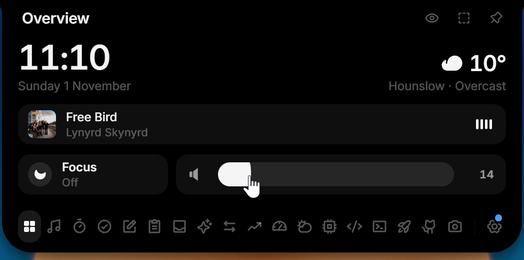</td>
    <td>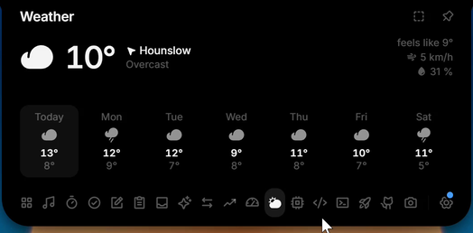</td>
  </tr>
</table>

## Productivity tools

- **Timer** with focus and break presets, custom durations, six alarm sounds and a running countdown in the closed notch. An expired timer stays visible until you dismiss it. A focus timer can play a background sound while it runs (white, pink or brown noise, rain or waves, generated on the fly without audio files), which fades in at the start and out when the timer ends, pauses or resets; the speaker button in the Timer mutes it until Crest restarts. The countdown comes in 12 looks and a colour you pick in **Settings → Timer**, and the button in the Timer's header pops it out into a small window that stays above other windows.
- **To-dos** and **notes** live on your machine and need no account. A to-do can have a due time; when it comes, an alarm sounds (unless you turn the sound off) and the to-do shows in the closed notch until you snooze it or mark it done. Type a date or time in plain English or Italian into the new-task field ("call Marco tomorrow 9am", "pay rent on friday", "send the report in 2 hours", "venerdì alle 17") and a chip under the field shows the due time it understood. Enter applies it: the task gets that due time and the words leave the title, unless they were the whole text. The cross on the chip drops the date and the task stays as typed. A day without a time is due at 9:00 (a morning 9:00, an afternoon 15:00, an evening or "tonight" 20:00), and a time without a day is the next one that comes, today while it is still ahead. A bare hour from 1 to 7 is the afternoon one ("call mum at 5" is 17:00); "5am" or "05:00" stays early. Crest would rather miss a date than guess, reads only the first date or time in the text, and uses no network for it. It is on by default while Crest is in English or Italian, and off in the other languages, whose words it does not know; **Settings → Tools**, under To-dos and Overview, has **Understand dates in new tasks**.
- **Clipboard** keeps a history of text, links, images and files, with filters and previews. Password managers are excluded on purpose, and nothing is written to disk.
- **Decode chips** in the Clipboard: hover a text or link entry that is a JWT, a Unix timestamp, Base64, a UUID, JSON, a hex colour or a link with tracking parameters and a small chip names it. Click the chip and what it decodes to opens under the row: a JWT's header and payload with its expiry and a note that the signature is not verified, a timestamp in local time and UTC, Base64 read as text, the UUID's version, JSON indented, a colour as RGB and HSL, or the link without `utm_*`, `fbclid`, `gclid` and a few other tracking parameters. The button in the view copies the result (**Copy without tracking** for a link). Crest is strict so the chips stay rare: Unix times only between 2000 and 2100, colours only with a `#` (a 3-digit code without a letter only if it is a grey, so `#123` stays an issue number), Base64 only from 8 characters and only if it decodes to plausible text, and texts up to about 100 KB. It is all worked out in memory on this PC; nothing is stored or sent. What you copy from the view goes on the normal clipboard, so it shows in Crest's history, and in Windows' Win + V history if you use it, like any other copy. The chips and the view are hidden in presentation mode. On by default; **Settings → Tools → Clipboard** turns them off.
- **Paste directly** in the Clipboard (off by default; **Settings → Tools → Clipboard** turns it on) makes a click on an entry paste it, as Win + V does: Crest copies the entry, gives the keyboard back to the app that had it before the notch opened and presses Ctrl + V there. What happens next is up to that app: a text field takes the text, Explorer copies files into the open folder, a chat attaches them. The notch closes as that app takes the keyboard. An image still opens its preview first, and the button there or on the card pastes it. When there is no app to paste into (it was closed in the meantime), the entry is only copied and the card says so. In presentation mode a click only copies, since the cards are hidden and a paste would show the entry in the app on screen. Windows does not let Crest press keys in an app that runs as administrator; the entry is still on the clipboard there, so Ctrl + V by hand pastes it. On a Mac Crest presses Cmd + V, which needs Crest allowed under System Settings → Privacy & Security → Accessibility: the first paste asks for it, and until then a click only copies. Crest presses the key where V sits on a US layout, so a Dvorak layout gets another letter.
- **Shelf** is a parking spot for files. Drop them onto the notch or press Ctrl + V, then open, copy or reveal them later. **Send to phone** shows a QR code for the picked files (or all of them): scan it and the phone's browser lists them and downloads them straight from the PC. It works on the local network only, over plain HTTP (the bytes are not encrypted on the Wi-Fi, and the link holds a random token), for one share at a time, and stops after 10 minutes, when the Shelf closes or when you stop it; a download already running finishes. Windows Defender Firewall asks the first time: allow private networks, or the phone cannot connect. It ends by itself if the PC changes network.
- **Scratchpad** is a code pad with syntax colouring for JavaScript, TypeScript, Rust and Python, or plain text. Each language keeps its own draft, saved as you type.
- **Water** logs what you drink against a daily goal (2 L unless you change it), with an hourly chart. Reminders are optional: every hour, or the interval you pick, between the times you set. **Quote in Overview** (in the Water settings) adds a one-line quote to Overview, with a button for another.
- **Converter** handles units (length, weight, temperature, volume, speed) and about 160 currencies at the reference rates of the European Central Bank and other central banks, through Frankfurter. The banks publish on different days, so each rate keeps its own date and the Converter shows the older one of the pair. Any two currencies convert through your portfolio's base currency, which is also the default. It opens on the units and currencies you used last.
- **Calc** is a notebook calculator, one calculation per line with the result on the right; a click on a result copies it. It reads units (`5 km in miles`, `72 F in C`, `2 km + 500 m`: length, mass, temperature, volume, speed, time and angles), percentages (`20% of 80`, `100 + 15%`), variables (`price = 12.5`, then `price * 3`), `ans` for the last result and `above` for the line above, the functions `sqrt`, `abs`, `round`, `floor`, `ceil`, `min`, `max`, `pow`, `log` (base 10) and `ln`, the angle functions `sin`, `cos`, `tan`, `asin`, `acos` and `atan` (they need `deg` or `rad`, as in `sin(30 deg)`), the constants `pi` and `e`, `^` and `mod`, and dates (`today + 3 weeks`, `days until 2026-12-25`, `now + 90 minutes`). Money (`120 GBP in EUR`, `£50 + €20`) uses the same central bank reference rates as the Converter, with the same currencies; Crest loads them only when a line names a currency and keeps them for 30 minutes. A line that cannot be worked out gets a faint red band and a short reason on the right, and `#` or `//` starts a comment. A line holds at most 200 characters, the sheet 500 lines and 20,000 characters. The sheet is saved as you type and stays on this PC, and Clear empties it with one undo. Off by default.
- **Colour** picks a colour from anywhere on the screen (**Pick from screen**), or reads one you type or paste. On Windows Crest freezes what all monitors show and a loupe under the pointer magnifies the pixels around it, with the hex value of the one in the middle: a click takes it, the arrow keys move the pointer by a pixel (ten with Shift) and Enter takes it, and Esc, a right click or a minute without a pick cancels. It works in the real pixels of every monitor, whatever each one's scaling, and Crest's own panel is left out of the frozen picture, so what it covered can be picked too. On a Mac the system's colour sampler does the same, without asking for screen recording. A typed or pasted colour can be hex with 3, 4, 6 or 8 digits (the `#` is optional), `rgb()`, `hsl()`, `oklch()` and common CSS names. **Values** copies the colour with a click as HEX, RGB, HSL, OKLCH or a ready CSS variable. **Contrast** checks the WCAG contrast against white, black and a second colour you pick (AA, AA large and AAA), and when AA is missed it offers a lighter or darker version that reaches it, with a button to use it. **Harmonies** shows complementary, triad and analogous colours, and a click takes one. The last 12 colours you chose are kept on this PC. Off by default.
- **Habits** tracks up to 20 habits, each with a name of up to 40 characters, one of eight colours and either every day or the weekdays you pick. Tap the circle on a habit's row to tick it for today and tap again to undo; only today can be ticked, and a day that is not one of the habit's days cannot. Each row shows the last five weeks as dots, the current streak and the best one. The streak is forgiving: only a habit's own days count, today stays open until you tick it, and a skipped day does not end the streak when at most one other day was missed in the 7 days before it (a third miss within a week does). A habit can follow the Water tool (the option shows while Water is on): it then ticks itself for today once the daily water goal is reached, takes the tick back if the goal is no longer reached, and cannot be ticked by hand. It only marks today, so days Crest did not see are not filled in later. Click a habit's name to edit it, move it up or down, or delete it with its history (two clicks). Two years of ticks are kept on this PC. Off by default.

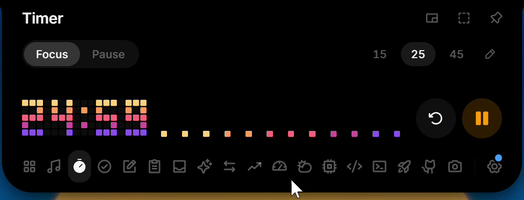

<table>
  <tr>
    <td>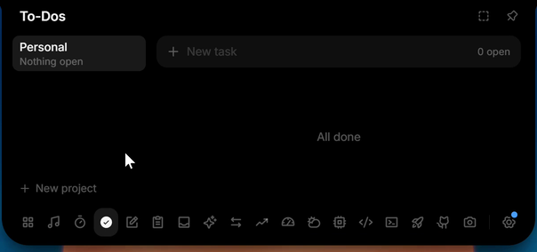</td>
    <td>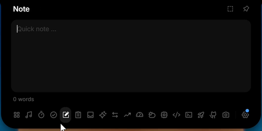</td>
  </tr>
  <tr>
    <td>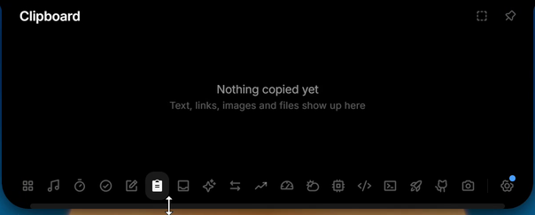</td>
    <td>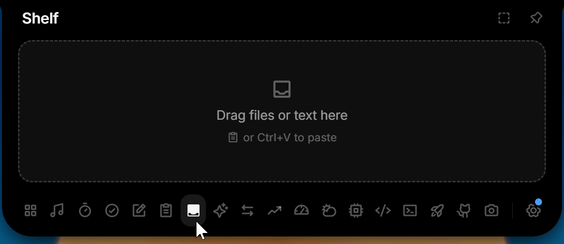</td>
  </tr>
  <tr>
    <td>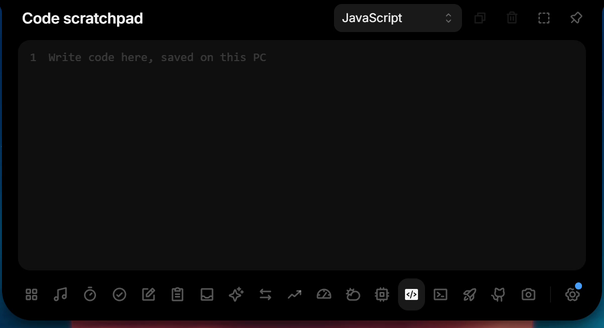</td>
    <td>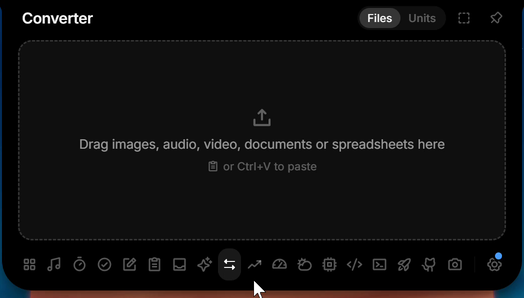</td>
  </tr>
</table>

## Break reminders

Reminders to rest your eyes and take longer breaks, off by default: switch them on under **Settings → Timer → Breaks**. They count the time you spend at the computer, not the clock.

- After 20 minutes of use a card in the closed notch asks you to look at something 20 feet away for 20 seconds. After an hour a break of 5 minutes comes in its place, with a suggestion in turn: stretch your arms and shoulders, drink a glass of water, look out of the window, take a short walk, stand up and stretch your legs. The card shows the time left and goes by itself when it is up. **Skip** counts the break as taken, and **Snooze 5 min** brings it back in five minutes.
- The eye break can come every 10, 15, 20 or 30 minutes, the long one every 45, 60, 90 or 120 minutes, and the long one can last 3, 5, 10 or 15 minutes. Changing any of them starts the count again.
- No keyboard or mouse input for 5 minutes, or a computer that went to sleep, counts as a break already taken, and the counts start over.
- A break waits, and comes back once the reason is gone, during presentation mode, over a full-screen app, while a window rule hides the notch or turns it into the line, with the line as the closed look, in focus mode, while a recording runs, while a finished timer, a question from `crest-notify ask`, a calendar event or a due to-do is on the notch, in Windows' Do Not Disturb, and in the notices' quiet hours when you turned the quiet window on. On the left and right edges the card shows only with the capsule look.
- While it is on, Crest asks the system every 15 seconds how long it has been since your last input. It sets no keyboard or mouse hook, and nothing is recorded or sent.

## Capture

- **Screenshots** of all screens, one screen or a region you drag, saved as PNG in Windows' *Screenshots* folder (Pictures\Screenshots, with the ones Win+PrtScn takes) and copied to the clipboard, optionally onto the Shelf too.
- **Recordings** of a screen or a window to MP4 in *Videos\Crest\Recordings*, at 30 or 60 fps, with system audio and the microphone if you want them.
- While it records, the closed notch shows the time with pause and stop buttons.
- Crest keeps itself out of its own screenshots and recordings. Other apps that record or share the screen see it too, unless you turn on **Hide Crest from screen sharing and recordings** (**Settings → Display → Presentation mode**, off by default). Then every Crest window stays out of what Teams, Zoom, Discord, OBS and similar apps capture, the floating timer and the copies on other monitors included, and out of your own Windows screenshots as well. On Windows it uses the system's capture exclusion (Windows 10 version 2004 and later; on older builds nothing changes). On a Mac it uses the window's sharing type, which some sharing apps ignore from macOS 15. An app that captures at a low level (a capture card, a hook in the graphics driver, a phone pointed at the screen) still sees Crest, so do not count on it to hide anything secret. The choice is applied once Crest's page has loaded, so Crest can be visible for a moment after it starts. With Glass and **Also the closed notch and capsule** on, the notch itself stays out of other apps' captures as well, whatever this setting says ([themes.md](themes.md#glass)).
- The tool lists what you took, with thumbnails and lengths; a deleted capture goes to the Recycle Bin.
- **Find on screen** (Ctrl+Alt+Shift+F, changeable in **Settings → Window**) reads the text on every screen with Windows' own text recognition, in your Windows languages or else English, and opens a search over it. Each result shows its line and screen; a click copies the line, the crosshair draws a frame around it on screen for two seconds. The screens are read in memory only, nothing is saved, and the text is gone when the page closes.

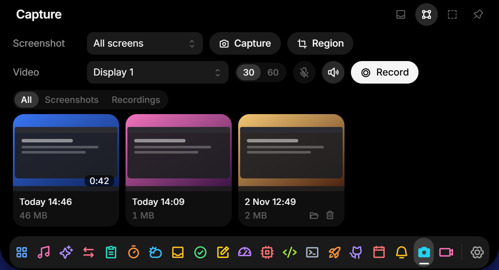

## Camera

A mirror for checking your hair and the light before a call, off by default. The tool shows the webcam picture, mirrored unless you turn that off in its header, and with several cameras a menu there picks one, which Crest remembers. The camera is on only while the tool is on screen: switching tools, closing the notch or hiding Crest turns it off. The picture is never recorded, saved or sent, and Crest's own use does not light the camera privacy dot. If Windows blocks the camera, the tool says where to allow it (Settings, Privacy & security, Camera), and it tells you when another app is holding the camera.

## Prompter

A teleprompter for calls and recordings, off by default. Turn it on in **Settings → Tools**.

- Write or paste a script (up to 50,000 characters, saved as you type on this PC) and press **Read**. The editor shows the word count and the reading time at the chosen speed. Reading always starts paused: Space or the play button starts it, and from the top it counts down 3, 2, 1 first (from the middle it goes on at once).
- The speed is in words per minute, from 60 to 300 (140 at first), and + and - change it in steps of 10. The text size goes from 16 to 72 px. Chinese and Japanese count about two characters to a word.
- **Mirror** flips the text for a glass teleprompter. The reading line sits a third of the way down, and the text fades out above and below it. The time left shows next to the sliders.
- Arrow keys move two lines, Page Up and Page Down 80% of the view, Home and End go to the ends. The mouse wheel over the text moves it instead of switching tools, and a click or drag on the marker at the right goes to that place. **Restart** goes back to the top, and the pencil goes back to the text.
- While it counts down or scrolls, the notch stays open even if the pointer leaves it. It pauses when you switch tools or the notch closes or hides, and reopens at the same place while the script is unchanged. The script stays on this PC and the tool uses no network.

## Terminal

- Runs PowerShell 7, Windows PowerShell or Command Prompt inside the notch, with a start folder and font size of your choice.
- The session can keep running while the notch is closed.

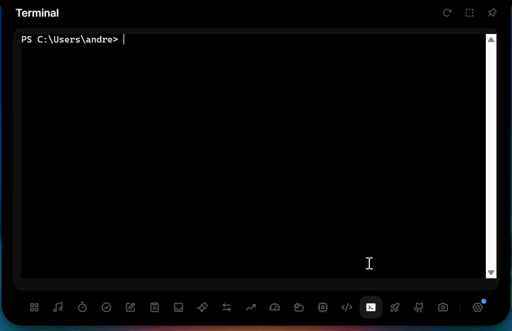

## Launcher, GitHub and LeetCode

- **Launcher** lists your pinned apps (detected AI apps such as Claude, ChatGPT and Cursor are pinned on first use) and starts them with a click. Any Start menu entry can be pinned. On Windows an app without one (a portable `.exe`, a game's `.lnk` or `.url` shortcut) is added with **Add from file** in the list of apps, or by dropping the file on the open Launcher; other files dropped there still go to the Shelf. It is the same pin as on Crest's bar, and it is removed in the Launcher's settings. If its file is gone, a click says the app is no longer installed.
- If you opt in, the first six also open with **Alt + 1** to **Alt + 6**, which then no longer reach other apps.
- **GitHub activity** shows the contribution calendar of a public username for the last 36 weeks, with the yearly total, today's count and your current and longest streak. A part in the closed notch shows today's count.
- It reads the public contribution page once an hour; a token without any rights is only needed if that page cannot be read.
- **LeetCode activity** shows the submission calendar of a public username for the last 36 weeks, with problems solved by difficulty (Easy, Medium, Hard), today's submissions and your current and longest streak. A part in the closed notch shows today's count.
- It reads the public profile via leetcode.com only once an hour, with no sign-in.

<table>
  <tr>
    <td>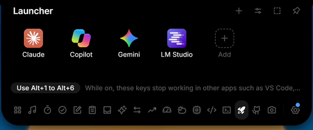</td>
    <td>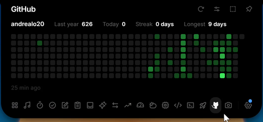</td>
  </tr>
</table>

## Calendar

- **Calendar** shows the month on the left, with a dot under each day that has events in the colour of its calendar, from the previous month to two months ahead. On the right, the agenda from the picked day (today unless you click another) and the next six days: each event with its calendar's colour, the time (or "All day") and the place. Past events of today are dimmed; a click on the month's name goes back to today.
- Sources are ICS links (the secret iCal address from Google Calendar, Outlook or iCloud, or any `webcal://` link) and CalDAV accounts (Nextcloud, Fastmail, iCloud, Radicale and others). It only reads; nothing is ever written back.
- Recurring events are expanded in their own time zone (daily, weekly, monthly and yearly rules with intervals, counts, end dates and weekdays), with skipped and moved instances. Time zones can be IANA names, Windows names (Outlook) or ones defined in the file.
- A notice in the closed notch 5 or 10 minutes before an event, and an optional **Next event** part that shows the title and time once an event is within 30 minutes to 8 hours, only while the Calendar tool is on (the row says so).
- An event with a Google Meet, Zoom, Teams or Webex link in its URL, place or description gets a **Join** button in the agenda and in its notice, which opens the meeting in your browser and hides the notice.
- The last good result is kept on disk, so the agenda still shows offline; a calendar that fails keeps its last events and shows the error in the settings.

## Clocks

World clocks, off by default. Turn them on in **Settings → Tools**.

- The first row is **Here**, your computer's time zone. The plus button adds up to 12 more: search the time zones your system knows by city or zone name (Tokyo, Kolkata). Each row shows the city and region, "tomorrow" or "yesterday" when its date differs from yours, how many hours it is ahead of or behind you, the time (12 or 24 hour as set in **Settings → General**) and a day or night dot (day is 6:00 to 18:00 there). Hover a row to move it up or down or remove it.
- The slider under the list moves the reference time up to a day either way in steps of 15 minutes, so you can see what 3 pm here is for everyone before you suggest it. The times turn blue while it is moved, and the arrow goes back to now. Daylight saving time is read for each moment shown, so a time a week ahead is right even when two countries change their clocks on different dates.
- The card on the right shows sunrise, sunset, golden hour (the sun between 4 degrees below and 6 degrees above the horizon) and the moon's phase with the share of the disc that is lit, for the place set under **Settings → General → Weather**, in that place's own time as the Weather tool shows it. Without a place it shows the moon only, with a button that opens those settings. On a day the sun does not rise or set it says so. Sun and moon are worked out on the PC to within a few minutes, with no network request, and the times are shown in your PC's time zone, also for a place in another one.
- The list of cities stays on this PC, and the clocks redraw once a minute while the tool is on screen.

## AI chat and usage

- **Ask** is a chat with Claude, ChatGPT, OpenRouter or any OpenAI-compatible endpoint, with streaming and adjustable reasoning effort. A local model through LM Studio or Ollama works without a key (see Setting up the integrations).
- **AI usage** shows your subscription limits for Claude, ChatGPT, Antigravity, Cursor and the Z.ai coding plan, and credits and balances for OpenRouter and DeepSeek.
- It also shows the tokens and cost of Claude Code and Codex today and over 7 days, read from their local logs. A models page breaks tokens and cost down per model for today, 7 or 30 days.
- Cards can be reordered, renamed, added and removed.
- Under each limit's bar a **pace line** shows where the bar will stand at the reset if you keep using it at the rate since the window began ("On pace for 62% at reset"), or when you would reach the limit if that comes first ("At this pace you reach the limit around 4:40 PM", with the day when it is not today). It stays hidden for a reading more than 15 minutes old, a window that has run for less than a tenth of its length, a limit already reached, and a window with nothing used yet. It is on by default; **Settings → AI → Quota forecast** turns it off.
- **Notify when a limit resets** (off by default, in the same place) shows a notice in the closed notch for 5 seconds when a limit that stood at 70% or more has started over. It needs the AI quota rings turned on, since they keep Crest reading the limits while the notch is closed, and it stays quiet in presentation mode and in the notices' quiet hours. It does not depend on the 70% and 90% alerts.

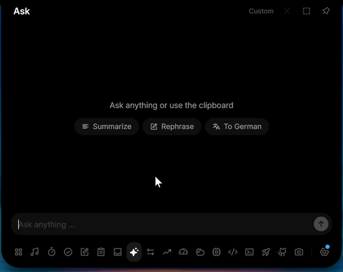

## Agents

Lists the Claude Code sessions on this PC, off by default. Turn it on in **Settings → Tools**.

- Crest runs `claude agents --json`, the command Claude Code offers for listing its sessions, every 10 seconds (counted from the end of the last reading) while the tool is on screen, and never while the notch is closed or Crest is hidden. It looks for `claude` on the PATH and in the usual install folders, starts it with fixed arguments, without a shell or a window, and ends it after 5 seconds. Crest reads only what the command prints: it installs no hooks and does not touch Claude Code's sign-in.
- Each row shows the session's name (or the last folder of its working folder), a coloured dot with its state in words (Working, Needs you, Idle, Done, Failed, Stopped), how long it has been running, and the full working folder. Sessions that need you come first, then failed, working, idle, done and stopped ones, the newest first in each group. A waiting session names its reason (Approval needed, Input needed, Sandbox request, Worker request, Dialog open) and, once it has waited a minute, for how long. Claude Code does not report when a wait began, so the time counts from when Crest first saw the session waiting.
- The button on a row copies `claude --resume <session id>`, to paste into a terminal.
- Up to 200 rows are drawn, then "+N more". If a reading fails, the last list stays with the error above it. If Claude Code is missing or too old to have the command, the tool says so, and the refresh button tries again.

## Hardware monitor

- **Hardware** shows live CPU, RAM, GPU, VRAM, network, power draw, battery, temperatures, ping, the busiest processes and your drives, with history that keeps recording while the notch is closed.
- Readings your PC cannot give (a battery on a desktop, a missing sensor) are left out.
- The **Power** row has a small menu with the Windows power plans: pick one to switch to it. It only shows when the PC has more than one plan; many Windows 11 PCs only have Balanced.
- Many PCs give Windows no CPU temperature, so while HWiNFO or LibreHardwareMonitor runs, Crest reads CPU and GPU temperature and power from it and Hardware names it as the source (in the power row, or when you point at a temperature). In HWiNFO, turn on **Shared Memory Support** in its settings (the free version switches it off after 12 hours); LibreHardwareMonitor only needs to be running.
- **Gaming mode** adds FPS to the readings in the closed notch, always or only while a fullscreen app runs. FPS works for DirectX, OpenGL and Vulkan games.
- Windows only allows FPS readings for members of the *Performance Log Users* group: click **Settings → Display → Unlock FPS** once, confirm the Windows prompt, then sign out and back in. A lock icon in the notch means this step is still missing.
- **Listening ports** (the plug button in Hardware's header) lists the TCP ports your PC is listening on, with the address, the program and its PID, sorted by port. The sheet reads them every 3 seconds while it is open and stops when you close it or the notch. A lock means the port answers only on this PC, an orange globe means other machines on the network can reach it. Each row can copy `localhost:PORT`, open it in your browser (only for ports that answer on localhost) and end the program. Ending asks twice: the first click turns the button into Confirm, and it goes back after four seconds. It stops the process at once, without asking it to close, so unsaved work in it is lost. Only your own programs can be ended, never Windows components, anything under the Windows folder or Crest itself, and Crest checks again that the port still belongs to that process before it ends it.

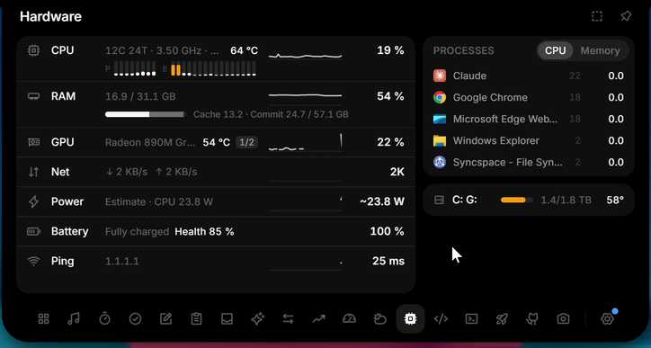

## Portfolio

- Combines Trading 212, Kraken, Coinbase, Binance, Bitpanda, eToro, Interactive Brokers and holdings entered by hand in one base currency.
- Profit and loss per account and in total, and a history chart.
- The app only reads, it never trades or moves funds.

<table>
  <tr>
    <td>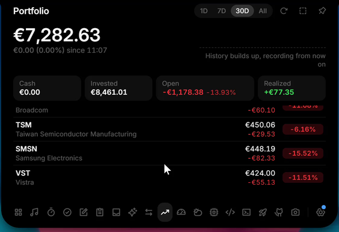</td>
    <td>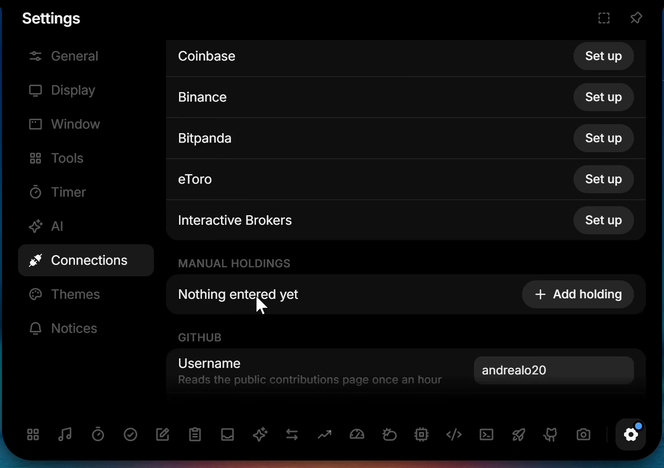</td>
  </tr>
</table>

## Vault

Passwords and two-factor codes, one hover away and encrypted on your PC.

- **Passwords** with name and username or email. Copy either one with a click, show or edit the password, or let the generator create a strong one.
- **2FA codes** with a live countdown. Screenshot the QR code (Win + Shift + S) and press **Ctrl + V**, or type the key, then name it.
- **4-digit PIN** before anything secret is shown or copied, adjustable for passwords and 2FA separately in **Settings → Tools → Vault**. Five wrong tries lock it for 30 seconds, doubling from there.
- **Never in clipboard history.** Copies skip the Crest clipboard and Windows' Win + V history, and passwords and codes leave the clipboard after 30 seconds.
- **Local only**, encrypted with Windows DPAPI and bound to your Windows account. Forgot the PIN? **Reset vault** in settings deletes everything; there is no back door.
- **Windows Hello (optional):** unlock with face, fingerprint or Windows PIN instead of the vault PIN. Secrets are then additionally encrypted with a key from your PC's security chip, so even malware running as you can't read them without your confirmation.

The vault is off by default; turn it on under **Settings → Tools**.

## Themes

- Fifteen built-in panel themes (Dark, Light, One Dark Pro, GitHub Dark, GitHub Light, Dracula, Night Owl, Catppuccin Mocha, Catppuccin Latte, Nord, Rosé Pine, Rosé Pine Dawn, Gruvbox Dark, Solarized Light and Everforest) under **Settings → Themes**.
- The editor changes background, foreground, accent and the warning colours with a colour picker and shows each change on the panel at once.
- Save the result as your own theme, export and import themes as JSON files, or switch between a day and a night theme, at two times you set or at sunrise and sunset.
- The closed notch stays black unless a theme opts in to colour it.
- **Coloured icons** (off by default) gives each tool in the tool bar, each Settings page, the weather, the Overview tiles, the Hardware rows and the closed-row readings a colour of its own. The colours are worked out for the active theme so they keep at least 3:1 contrast, on light and custom themes too. Over the glass the tool bar keeps one ink instead ([themes.md](themes.md#glass)).
- Tint from the album art (off by default) gives the open panel a soft glow of the cover's colour from the top while a song shows, fading between songs and behind the content, so text keeps the theme's contrast.
- **Glass** (off by default, Windows): the open panel shows the screen behind it, bent along the sides and blurred in the middle, from a copy Crest keeps in memory while the panel is open. Sliders set its transparency, refraction, frost and rim light, and the tool bar becomes a capsule of glass, where the highlight that follows the pointer from tool to tool (a brighter pill without Glass, moving the same way) is a drop of glass that magnifies the icon under it. Up to the Transparency mark, text keeps the theme's contrast, so under it the panel stays mostly opaque. With **Also the closed notch and capsule** on (Windows 11 24H2 or later on x64, not in the Microsoft Store version for now), the closed notch and the capsule are glass too, over a live copy of the screen around them, and while it is on they stay out of screenshots, recordings and screen shares. Details in [themes.md](themes.md#glass).

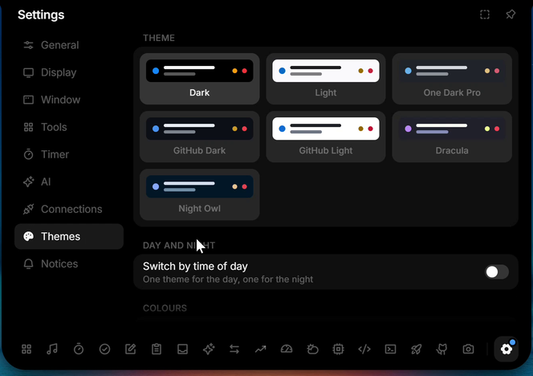

Details: [themes.md](themes.md).

## Taskbar

**Settings → Taskbar → Appearance** sets the look of Crest's own taskbar (Windows):

- **Position**: **Bottom** (the default) or **Top**, for the bar on every monitor. Menus, previews, the panel and the names open away from the bar, and **Auto-hide** slides it off its own edge. Start, search and Windows' own panels still open at the edge of Windows' taskbar, which Crest leaves where it is.
- **Shape**: **Docked** runs the full width along its edge with square corners and no gap, as Windows' taskbar does, and with **Auto-hide** off it reserves that strip on every monitor, so maximized windows stop short of it (the other shapes float over the windows; when another program stands in for Windows' taskbar the docked bar floats too, and **General** says so); **Floating** (the default) stands 4 px off the sides and its edge with round corners; **Capsule** sits in the middle, as wide as its buttons, growing and shrinking as apps open and close; **Tiles** has no band behind, and puts each button on a tile of its own as tall as the bar, 6 px apart, with the zones where they are. As a capsule the bar lines the three zones up in the middle, left, centre and right; **Items** says so under the zones, and the zones saved there stay as they are.
- **Height** (32 to 64 px, 44 by default) and **Icon size** (16 to 40 px, 24 by default), for every shape. A low bar draws smaller icons and gives back the saved size when it grows again. A **Docked** bar with **Auto-hide** off takes a new height when you let go of the slider, so maximized windows resize once.
- **Background**: **Notch** takes the closed notch's black, **Theme** the theme's background colour. With Tiles it is on each tile. With Liquid Glass + the bar's content is always white and Background does not apply.
- **Transparency** (0 to 100%, 0 by default, an opaque bar): the number beside it is how much of the screen behind shows through. Without Glass the bar goes from opaque to fully clear, icons left; with Glass it goes from the veil that keeps every text readable to the theme's clearest veil, as the notch's Transparency does. With Liquid Glass + it sets how far the glass darkens over a light screen, between Dark's two veils whatever the theme (22% and 41% of a white page showing through); over a dark one Liquid Glass + stays as clear as the widgets it follows. With transparency effects off, more contrast or forced colours in Windows the bar stays opaque.
- **Open app marker**: **Dot** (the default), **Large dot** or **Line**, the mark under an open app; the app in front gets a longer one. Under Material the app in front has its pill as before.
- **Glass**: **Off** (the default), **Glass** or **Liquid Glass +** (Windows 11 24H2 or later on x64, not in the Microsoft Store version for now; the choice shows only there). Either shows a live copy of the screen behind the bar, up to 10 times a second: **Glass** bent at the rim and blurred as the notch's glass, **Liquid Glass +** as the widgets of LiquidGlassWindows draw their glass, with a strong lens along the edge, red and blue a little apart, almost no blur, round ends and white content. Either needs more battery, and while one is chosen the bar is left out of every screenshot, recording and screen share, Crest's own included. It is separate from the notch's glass: either can be on alone. Under it, **Refraction**, **Frost** and **Rim light** are the notch's own sliders (**Settings → Themes → Glass**), shown here too: moving them changes both.
- Colours and theme are the ones of **Settings → Themes**, with a button to get there.

Details of the glass, and what it costs: [themes.md](themes.md#glass).

While the bar is on, its edge is the bar's: a notch or line hanging there moves away when the bar comes on (to the bottom from the top, to the top from the bottom), and **Screen edge** offers that edge again once the bar is off.

**Settings → Taskbar → Items** also places the **Notification area**, the tray, like a widget: it comes once before the clock, can be taken off with its cross and added back with a zone's **Add widget**. On the bar it shows the icons you keep visible, one button each (left, right and double click reach the program as from Windows' tray, and so does the pointer resting on one, so an app that draws its own popup shows it), then a **^** button, "Show hidden icons", for all the others; an icon dragged from there onto the bar stays visible, and the order on the bar is yours. The order in the ^ panel is yours too, by dragging inside it, and an icon dragged from the bar onto a place in the panel goes there. A right click on an icon in the panel keeps the panel open while the app's menu shows, and the panel closes with the menu or when another program comes to the front. By default every icon is behind the ^. Crest records the tray's icons only while a bar shows the tray; with the tray taken off or the bar off, Windows' tray keeps them all.

Beside each zone's **Add widget**, **Add tool** puts a button for one of Crest's tools on the bar, with the tool's icon. **Overview**, **Now Playing**, **AI Usage**, **Hardware**, **Notices**, **Shelf**, **Note**, **To-Dos**, **Water**, **Code scratchpad**, **Habits** and **Clocks** open in the panel over the bar, the others and **Find on screen** open the notch on that tool. A tool that opens in the notch is offered, and its button shows, only while it is on in the notch's tool settings; switched off later, its button leaves the bar and its row in **Items** says "Off in the notch". **Timer**, **Discord**, **GitHub**, **LeetCode**, **Calendar** and **Weather** are not offered, since their widget opens the same panel. Tool buttons show on the main bar only, as widgets do. In the panel **Clocks** shows sunrise, sunset and golden hour in the PC's time zone, for a place in another one, until the **Weather** widget's panel has been opened on the bar.

**Add Windows button**, beside them, puts one of Windows' own buttons on the bar: **Search**, **Task view** and **Windows widgets** open Windows' own, as Win+S, Win+Tab and Win+W do, and **Show desktop** is a narrow button with a thin line at its edge that shows or hides the desktop, as the corner of Windows' taskbar does. **Input language** shows the keyboard language of the window in front over its region, as Windows' indicator does ("ITA" over "IT"), only while more than one keyboard layout is installed, and a click opens Windows' switcher, as Win+Space. **Privacy indicators** shows a microphone, a camera or a pin while an app uses them, as Windows' icons by the tray do (Crest's own use is left out), nothing otherwise, and a click opens Windows' privacy page of the first. **Recycle Bin** shows whether the Recycle Bin holds anything, and how many items, in its name; a click opens it in File Explorer, and its right-click menu has **Open** and **Empty Recycle Bin**, which asks Windows' own confirmation first. It follows what Windows reports, nothing reads at intervals. A right click on the others opens the Crest menu. **Windows widgets**, **Input language**, **Privacy indicators** and **Recycle Bin** show on the main bar only, the others on every bar.

Five widgets come in versions, chosen in **Settings → Taskbar → Widgets**: **Weather** as the temperature (the default), the icon only, the icon with the temperature over the conditions, or the next three hours; the **Clock** as the time and date (the default), the time only, an analog dial, or two time zones, the time here over the difference and the time in the first zone of the **Clocks** tool (offered only while it has one); **Hardware** as dials (the default), bars or a line of the CPU's last 30 seconds, always with the readings switched on for the notch, the others drawn as dials beside the bars or the line; the **Timer** as the countdown (the default) or a ring that empties; **Disk space** as the system drive (the default), every drive, or the fullest drive. A version the bar does not know draws the default.

**Disk space**, a widget of the bar alone (the closed notch has no such part), shows each drive it draws as its letter and free space over a bar filled to its use, red under 10% free. A click opens a panel over it with every lettered drive, the internal ones first, then the ones that plug in (USB sticks, cards and USB disks), each with its name, letter, free and total space and its own bar; a click on a row opens that drive in File Explorer. It lists the drives the Hardware tool shows, so a partition under 1 GB, a virtual disk and a drive still locked by BitLocker (Crest cannot read its free space; open it from File Explorer to unlock it) are left out. Crest reads the drives every five minutes while the widget is on the bar and as the panel opens, never more often, so idle disks are not kept awake, and it asks no drive for its temperature for this. Crest does not follow devices being plugged in or out, so a drive plugged in shows the next time the panel opens.

**Settings → Taskbar → Widgets** shows every widget with a preview of how it looks on the bar, drawn from sample data on the bar's own surface, its versions to pick with a click or the arrow keys, and **Add** (to a zone) or **Remove** beside it; the Crest menu's **Add widget** opens it. **Items** keeps the order. The clock's date is picked here, as the version **Time and date** or **Time only**; its seconds stay in **Items**, for those two versions only, since **Analog** and **Two time zones** draw none.

Widgets, tool buttons, Windows buttons and Stato also drag along the bar itself: press one and move it past 4 px with a mouse (10 px by touch or with a pen), and a line shows where it goes, in its zone or another; let go there and it moves, written once. Start, the apps and the Crest button stay where **Items** puts them; the tray's icons and the pinned apps drag as their own (below). Let go outside the bar, or press Esc, and nothing changes; a widget is never taken off the bar by a drag. On the **Capsule**, whose zones have no borders, a drop joins the zone of the item it lands before (of the last item at the end), and a drop on the item's own place, or right after it, changes nothing even where two zones meet, so moving an item into the next zone there is done in **Items**. Widgets the bar has no room for keep their places.

When the apps do not fit, their buttons narrow first, then the last ones go behind a **…** button (with one button per window, the last windows); the app in front and those asking for attention stay on the bar. Its panel lists them five to a row: a click does what it does on the bar, a right click opens the app's menu. With too little room even for one app and **…**, the tray's kept icons go back behind the ^, then the widgets, tool buttons and Windows buttons farthest from the bar's centre hide, so nothing leaves the screen and the widgets never cover the apps. This holds on every bar, on every monitor. The tray's icons are two thirds the size of the apps'. Under the pointer the apps, Start, **…**, the Crest button, **Search**, **Task view** and **Windows widgets** grow like a dock's icons, their neighbours a little less, and the names above them rise to stay clear; widgets, tool buttons and tray icons only lift. With reduced motion in Windows they all only lift.

**Double click on empty space**, in **Settings → Taskbar → General**, sets what a double click on the bar beside its buttons, or in the gap under it, does: **Nothing** (the default), **Show desktop** or **Task Manager**. **Show on all displays**, also there, gives the other monitors a bar of their own (on by default); off, they have no taskbar at all, neither Crest's nor Windows'. With it on, **Show apps on** picks where an app's button shows, as in Windows: **All taskbars**, **Main taskbar and taskbar where the window is open**, or **Taskbar where the window is open** (the default), and **Clock on every taskbar** puts the clock on the other bars too. While **Notices** reads Windows' notifications, the main bar's clock shows how many wait in Windows' notification centre. With **Show flashing on apps** off, an app asking for attention no longer pulses, stays behind **…** like any other and does not hold the bar up.

**Combine taskbar buttons and hide labels**, in **Settings → Taskbar → Apps and windows**, works as Windows' own setting. **Always** (the default) gives each app one button with no label and its name above it under the pointer. **Never** gives each window a button of its own with its icon and title, beside the other windows of its app; a pinned app with no window keeps its icon alone. When those buttons do not fit they narrow, then drop their titles, then fold as above, so only the windows without room go behind **…**. **When taskbar is full** shows a titled button per window while they all fit and goes back to one button per app when they do not. A window's button brings that window forward or minimizes it, shows its preview alone and its right-click menu closes that window. While the bar shows titles its apps' buttons, a pinned app's icon alone too, only lift under the pointer. A pinned app's window buttons drag as one, and a dragged pin or exe lands before or after all of them. The choice is the same on every bar. With **Show windows from all desktops** on (off by default), the bar lists the windows of every virtual desktop, and a click on one of another desktop brings it forward there.

The first button on the bar is Windows' own Start: a left click opens the Start menu and a right click the Win+X menu, drawn with the Windows mark in the bar's colour. Apps are pinned from Windows' Start, with **Pin to taskbar** in an app's right-click menu, or by dragging an exe or a shortcut from File Explorer onto the apps. Any app with an open window can be pinned, a portable exe or a development build too: Crest pins the command the app gives Windows for that, or else its exe. An app that asks Windows never to be pinned has no **Pin to taskbar**, as on Windows' taskbar. Pinned apps drag along the bar to change their order, past 4 px with a mouse (10 px by touch or with a pen); let go off the bar, or press Esc, and nothing changes. Apps that are open but not pinned stay after the pinned ones.

An app's right-click menu has, as on Windows' taskbar, the app's name, which starts a new instance, then **Pin to taskbar** or **Unpin from taskbar**, **Open file location** for an open app, **End task** once **End task in the app menu** is on in **Settings → Taskbar → Apps and windows** (off by default, since it ends the app at once without saving; while it is off Crest refuses to end an app whatever asks; it leaves alone the explorer.exe that draws the desktop, and an app running as administrator may refuse it), and **Close window** or **Close all windows**. Shift+click and a middle click start a new instance too, and Ctrl+Shift+click starts one as administrator after Windows asks (nothing happens for a Store app). Ctrl+click brings the app's windows forward one after the other. **Middle click**, in **Settings → Taskbar → Apps and windows**, can close the app's windows instead (**Close**; an app with unsaved work asks first, and one running as administrator may refuse). **Show the number of windows**, also there, puts a small count on the icon of an app with two windows or more. A file dragged from File Explorer and held over an app brings its window forward after a moment, or opens the previews of an app with several.

Above those entries the menu shows the app's jump list, as Windows 11 does: what the app keeps there, such as a browser's new private window, its most visited pages or Terminal's profiles, then the files it opened recently or often, with **Tasks** last. A click opens the item with that app. Recent and frequent files follow Windows' **Show recently opened items in Start, Jump Lists, and File Explorer**, and come through Windows' documented interface. The tasks and the app's own categories are read from the file Windows keeps for each app, whose format Microsoft does not document: a file Crest cannot read whole is skipped, and the app then shows its recent files only. The items pinned to an app's jump list on Windows do not show, and an item cannot be pinned there from Crest yet. A program without a Start entry or an app id of its own, such as a portable exe, has no jump list.

The mouse wheel over **Status** changes Windows' volume, two percent a notch. With **Mouse wheel changes the volume** on, in **Settings → Taskbar → General**, the whole bar does: over an app it changes that app's own volume and shows the new level above its button (or that it plays no sound), elsewhere on the bar Windows' volume.

Holding the pointer on an app with open windows shows a live preview of each beside its button, on the screen's side, after a moment, as Windows 11 does, and moving to another open app switches the previews at once. A click on a preview brings that window forward and its cross closes it; a click on an app with several windows opens the previews at once, and a second click closes them. Opened by a click (Enter or Space on a focused button too), the keyboard moves into the previews: the arrow keys go from window to window, Enter brings one forward and Esc closes them. With more windows than the room takes, or when no preview can be drawn, they list by title. A minimized window shows its app's icon in its place, and an app whose windows are all minimized lists them by title: Windows 11's own taskbar has a picture of a minimized window, but no documented API gives it to another app, and Crest does not restore windows out of sight to take one. Apps that draw their own previews, as a browser does for its tabs, show their whole window. The live pictures of the windows never show in screenshots or screen shares; the titles around them do, unless **Hide Crest from screen sharing and recordings** is on. A preview dragged sideways moves its window in the row, and the app's windows keep that order on the bar until Crest restarts.

Shift+right-click on an app with one window opens that window's menu: **Restore**, **Move**, **Resize**, **Minimize**, **Maximize** and **Close**, each available as in Windows' own menu. On an app with several windows it opens the group's: **Cascade windows**, **Show windows stacked**, **Show windows side by side**, **Restore all windows**, **Minimize all windows** and **Close all windows**, arranged on that bar's monitor. Entries an app adds to its own window menu are not shown.

With **Windows keys on the bar** on (**Settings → Taskbar → General**, off by default), Win+1 to Win+9 and Win+0 act on the bar's apps in their order, those behind **…** too, as on Windows' taskbar: the key starts the app, brings its window forward or minimizes it, or opens the previews of an app with several windows. Win+Shift+number starts a new instance, Win+Ctrl+Shift+number one as administrator, Win+Ctrl+number goes to the app's next window and Win+Alt+number opens its menu. Win+T moves the keyboard to the first app and on to the next at each press (Win+Shift+T goes back); Win+B moves it to the **^** of the notification area. The keys go to the bar on the monitor of the window in front. To have these keys Crest adds them to DisabledHotkeys, a value of Windows Explorer's that Microsoft does not document, and restarts Explorer when the option or the bar is turned on or off and after Crest quits; open File Explorer windows may close then. It uses no keyboard hook. At sign-out the value stays while Crest starts with Windows, so the next sign-in needs no restart; uninstalling Crest takes it out, and Windows has the keys again from the next sign-in. Crest running as administrator never restarts Explorer, since the new Explorer would run as administrator too: the keys then stay with Windows. If Windows does not let go of them, or another program holds some, **General** says so.

Inside the bar the arrow keys go from button to button, Home and End to the first and the last, Shift+F10 or the menu key opens a button's menu, and Esc gives the keyboard back to the app in front. A screen reader hears each app's name with its state: pinned, how many windows are open, in front, asking for attention.

Apps that mark their button on Windows' taskbar mark it on Crest's too: a badge on the icon (unread messages in Telegram, Discord or Outlook), read after the app's name by a screen reader, and a line under it for a download, a copy or an installation (green, yellow while paused, red after an error, a moving segment while the app cannot say how far it is). Windows' own taskbar gets all of it as well, and when Crest gives the tray back it asks the apps to report once more, since part of what they send (a player's buttons, the badge's text) may not reach Windows on the way. The badge's text is not read from an app running at low integrity, such as a sandboxed process. Crest receives them the way Windows' taskbar does, which is not a documented API and may change; then the bar shows none of them and the rest works as before. They come through Crest's notification area, so they show only while a bar holds the tray, and are missing while another program stands in for Windows' tray. The buttons a player puts under its preview are not on Crest's previews yet. Windows an app keeps off Windows' taskbar stay off Crest's bar too; Crest reads that from a window property Windows sets for them, which Microsoft does not document either.

Apps pinned or unpinned in Windows' Start show up on the bar or leave it, changes made while Crest was closed included. Windows' pinned shortcuts show up even without an entry in Start, a site pinned from Edge or a portable exe pinned from File Explorer, say, and they start from that shortcut. Crest's pins and Windows' are two lists: a pin added or taken off on Crest's bar does not reach Windows' taskbar, and with Crest's bar off Windows' own list is the one that shows. A read of Windows' pins in which more than half of them are gone at once changes nothing until the next read finds the same ones gone (a reset by a Windows update, say), and **Import from Windows** (**Settings → Taskbar → Apps and windows**) starts the following again from what it imported. The bar's Crest menu has **Task Manager**, **Add widget** and **Auto-hide**.

**Status** (Settings → Taskbar → Items, placed once before the clock like the Notification area) shows the network in use, the volume and the battery as one button, on every bar: Wi-Fi with its signal, the cable, Wi-Fi off or no network; the speaker as the volume and the mute; the battery filled to its charge or charging, green with Energy saver on, and left out on a PC without a battery. It sits on a rounded pill, and so do the **Weather** and **Hardware** widgets, except on Tiles, whose tile is already one. It changes only when Windows reports a change, nothing on the bar reads at intervals; the Wi-Fi signal follows Windows' own signal notifications once Crest has location access, from the first **Show nearby networks** on the Wi-Fi page after Crest starts, and until then moves only with a change of network. A click opens Crest's quick panel over it: Wi-Fi and Bluetooth tiles (each only where the PC has the radio), whose left part switches the radio and whose arrow opens its page inside the panel, the volume with the choice of output as in Overview and, beside it, **Volume mixer**, a page with each app's volume and Windows' own, the brightness of that bar's monitor where Crest can set it, buttons three to a row (**Energy saver** with its state, **Airplane mode** and, while a cable carries the internet, **Ethernet**, each opening its page in Windows' Settings; the **Microphone** mute, switched from the panel; **Cast**, which opens Windows' Cast panel; **Night light**, **Do not disturb** (with its state) and **Accessibility**, which open their pages in Windows' Settings), and **More settings**, which opens Windows' Settings. The Wi-Fi name shows only when Windows gives it without location access; otherwise the panel says "Connected". While a cable carries the internet the Wi-Fi tile says only whether Wi-Fi is on. The Wi-Fi page lists the networks nearby once Windows allows Crest location access, which Windows asks for at a click on **Show nearby networks** and never before: a saved network connects with a click, a new secured one asks for its password in its row, a company network opens Windows' Settings, and the network in use disconnects; in the Microsoft Store version the page sends you to Windows' Settings. The Bluetooth page lists the paired devices, the connected ones first with their battery, each opening Bluetooth in Windows' Settings; like the alerts it reads the list Windows keeps and never searches for devices.

## Live notices and crest-notify

- Turn on **Settings → Notices** and Windows notifications from any app show in the closed notch for 6 seconds, with the app's logo, name, title and text, and land on a **Notices** page in the open notch.
- Each app can be shown, muted (history only) or turned off.
- A notice that contains a one-time code, such as "Your verification code is 482913", gets a **Copy code** button on its card in the closed notch and on the **Notices** page. Crest looks for 4 to 8 digits (also written as 123-456 or 123 456) within 40 characters of a word like code, OTP, passcode, verification or PIN, in each of Crest's languages, and leaves out years, dates, times, amounts, phone numbers and order numbers. The button copies only the digits, keeps them out of Crest's clipboard history, Windows' Win + V history and the cloud clipboard, and empties the clipboard after 30 seconds unless you copied something else meanwhile. Crest holds the code only for the click; the notice itself stays in the history like any other. There is no button for a notice that reports progress or for a `crest-notify run` result, and none while presentation mode hides the text. It is on by default; **Copy button for one-time codes** in **Settings → Notices** turns it off. The private copy is Windows only.
- **Hide Windows banners** (in the same settings, off by default; not in the Microsoft Store build) turns off Windows' own pop-up for the apps Crest shows, so a notification appears once, in the notch, and stays in the action centre. Crest gives the banners back when you switch it off, when it quits and when it is uninstalled.
- Presentation mode, a full-screen app, Crest's focus mode, Windows focus or Do Not Disturb, and an optional daily quiet window keep them in the history without popping up.
- Scripts, builds and coding agents can send their own notices with `crest-notify`, including `crest-notify run -- <command>` for the exit code and duration.
- `crest-notify part` sets a custom part of the closed row (icon, text up to 48 characters, progress, a tool to open on click, an optional time to live); turn on **Script parts (crest-notify)** among the closed-row parts. It shows nothing while live notices or crest-notify are off, and the row says so.
- `crest-notify ask` shows a question with up to four buttons (by default **Allow**, **Always allow** and **Deny**) and prints the one you click, so a coding agent's permission request can be answered from the notch. It stays until answered or its time runs out (2 minutes by default), and with no answer the caller falls back to its terminal prompt.

Details, ready-made hooks for Claude Code and Codex (including a permission hook that uses `ask`), and how notifications are read: [notices.md](notices.md).

## Plugins

Windows only for now; on a Mac the Plugins page is hidden.

- A plugin is a small HTML, CSS and JavaScript widget in a folder with a `crest-plugin.json`. Install one from a folder or a `.zip` in **Settings → Plugins**; it becomes a tool with its own icon in the tool bar.
- Before installing, Crest shows what the plugin asks for: the addresses it may fetch from, its own storage, and notices in the closed notch. Nothing else is possible: no files, keys, vault, clipboard, settings or other plugins.
- Plugin pages run in a sandboxed frame that cannot reach the network itself; Crest fetches for them, only over https and only from the hosts they declared.
- Switch a plugin off like any tool, or remove it with its data in **Settings → Plugins**. A sample plugin is in `examples/plugins/hello-crest`.

Format, API, limits and the security model: [plugins.md](plugins.md).

## Screen edges, window rules and panel size

- **Any screen edge.** **Screen edge** in **Settings → Display** hangs the notch and the line from the top, bottom, left or right edge, from the screen's edge or from the taskbar's. Dragging the closed notch towards another edge moves it there. The capsule stays on the top. While Crest's taskbar is on, the bar's edge is the bar's: **Screen edge** leaves it out and says why, a drag towards it leaves the notch on its edge, and a notch on that edge moves away (to the bottom from the top, to the top from the bottom), with its default anchor, as the bar comes on; with the bar off again that edge can be picked once more.
- **More monitors.** **Monitor** in **Settings → Display** (shown with two or more monitors) puts the notch on one monitor, or picks **Follow the cursor** or **All monitors**. Following, the closed notch moves to the monitor the pointer has stayed on for about a third of a second, so crossing a screen edge does not move it; it never moves while open, peeking, dragged or recording. With All monitors every other monitor shows a copy of the closed notch, updated a few times a second while the notch is closed (while it is open, pinned or turned into the line or hidden by a window rule, the copies keep the last closed picture); hovering it brings the notch there, where it opens as usual, and the copy moves to the monitor the notch left. The edge, the anchor and the offset are the same everywhere, each monitor with its own size, scale and taskbar, and monitors plugged in or out are picked up within a second. A copy hides with the hide shortcut, and on its own while a window on its monitor (the one in front, or behind it when **Settings → Window** checks the windows behind) calls for the line or hiding under the window rules. Each copy is one more WebView2 window, about 70 MB more memory.
- On the left and right edges the parts stand in a column, without the song title, the next event, script parts and downloads, and a notice shows as one icon: a finished timer (click to dismiss), a status alert, a live notice's app logo or a due to-do (click to open the To-dos).
- **Screen and app rules.** **Settings → Window** chooses what Crest does while a maximized window, a borderless full-screen app or an exclusive full-screen game covers its monitor: keep its look, turn into the line, or hide. When Windows' taskbar auto-hides, or a monitor has no taskbar, a maximized app that draws its own title bar counts as maximized, not full screen. Full-screen video and a browser after F11 still count as full screen. It can also check the windows behind the one in front. Rules per app, picked from the running apps or typed, override these.
- **Panel size and scale.** Drag the open panel's sides, bottom or bottom corners to size each tool (double click resets), or pick Compact, Standard or Spacious for all of them. **Resize by dragging the edges** turns the grips off, leaving the size to Settings and the resize shortcut. The whole notch can be scaled from 80 % to 200 % with the − and + buttons in Settings, Window.

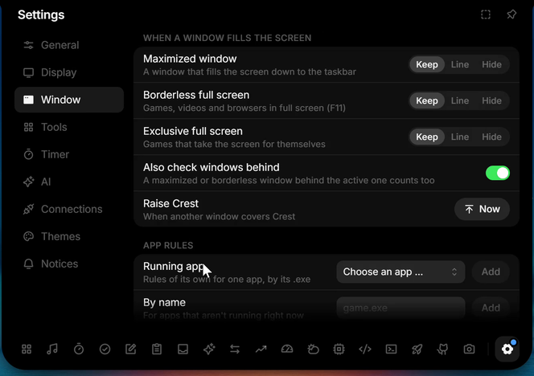

## Shortcuts

- Opening and closing, hiding and showing Crest, resizing the panel with the arrow keys, Find on screen and muting the microphone each take a shortcut you record in **Settings → Window**. Opening and Find on screen start with one; the others stay empty until you record theirs.
- Any tool in the dock can have a shortcut of its own: **Open a tool directly**, under the shortcuts, adds one (the Clipboard, the Shelf, a plugin's tool and so on). It opens the notch on that tool from anywhere, switches to it while the notch shows another, and closes the notch when that tool is already showing. It follows the open shortcut's rules, and a tool that is off keeps its shortcut but only listens to it once it is on again.
- Crest tells you when another program, the launcher's Alt keys, one of Crest's shortcuts or another tool's already use it.
- Opening Crest on purpose (shortcut, tray) shows it even while a rule hides it, until it closes again. A second launch opens the settings window and brings back a Crest hidden with the shortcut, while a rule keeps hiding the notch.
- Right click on the notch opens the settings window, and the mouse wheel switches tools.

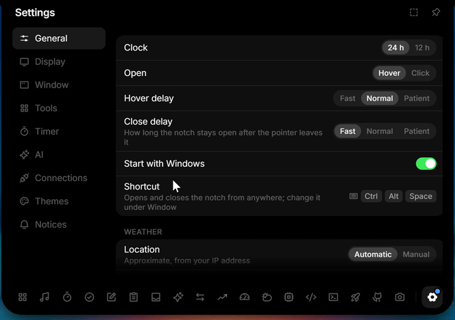

## Portable build

- A zip that runs from any folder you can write to, with nothing installed and its data in a folder next to it. See [Install](../README.md#install).

## Using it

| Action | How |
| --- | --- |
| Open or close | Hover, click or **Ctrl + Alt + Space** (choose the trigger in settings) |
| Switch tools | Tool bar at the bottom of the open notch |
| Settings | Gear icon at the end of the tool bar, a right click on the notch, **Settings …** in the tray menu, or starting Crest again |
| Tray icon | Left click opens the notch, right click shows the menu (open, settings, autostart, quit) |
| Focus mode | With **Focus mode with three clicks** on in **Settings → Display**, three quick clicks on the closed notch. Three more bring it back |
| Move the notch | Drag it along its edge, closed or by its header; drag the closed notch towards another edge to move it there. "Reset to center" is in settings |
| Add files | Drag them onto the notch, or paste with Ctrl + V |

## Settings

The settings open in a window of their own, apart from the notch: from the gear at the end of the tool bar, a right click on the notch, **Settings …** in the tray menu and the links in the tools (a "connect" button without a key, for example), or by starting Crest again, which also brings back a Crest hidden with the shortcut. Opening them while the window is open brings it to the front, on the page asked for. The window shows in Alt + Tab, is moved by its title row, follows the theme and the language, and closing it frees its memory. A change made there shows at once on the notch and the timer window, and the notch applies it, so the window can close at any moment, also in the middle of recording a shortcut. The browser demo keeps the settings in the panel.

Settings are grouped into General, Display, Window, Tools, Timer, AI, Connections, Themes, Notices and Plugins. The search field above the pages (**Ctrl + F**) finds a setting by its name, its description or its group, in the interface language or in English, and a click opens its page with the setting highlighted. There you can reorder (drag) or hide tools, pick the monitor and the screen edge, set what the notch does over full-screen and maximized windows, record shortcuts, and enable autostart. The very first launch turns autostart on (not in the Store build or a portable copy; on a Mac only once Crest runs from Applications): switch it off in General or in the tray menu, and before deleting the app on a Mac, since the login item stays otherwise. Language, in General, is System (the Windows language, or English when Crest does not have it) or one of English, Simplified Chinese, Spanish, Hindi, Arabic, French, Portuguese (Brazil), Russian, Japanese, German and Italian; it switches at once, tray menu included, and numbers and dates follow it. In Arabic the panel reads right to left, while the closed notch, the sliders, the song's time bar and key combinations keep their left to right order.

**Backup**, in General, saves settings, notes, to-dos and every tool's data as one file in Documents › Crest › Backups (named like `Crest backup 2026-11-10 140501.json`), and **Show in folder** opens it there to copy it elsewhere. API keys and passwords are not in it, as they stay in Windows Credential Manager (the Keychain on a Mac), and neither is the Vault, whose encrypted file only opens under your Windows account: on another PC you enter the keys again and install the plugins again. **Restore from a backup** asks for such a file and its date shows for a yes or no. Once confirmed, Crest first saves the data it is about to replace as `Crest before restore ….json` in the same folder, then restarts and replaces all of its data with the backup's before anything reads it. A file from a newer Crest is refused, and when the data does not fit, the old data stays.

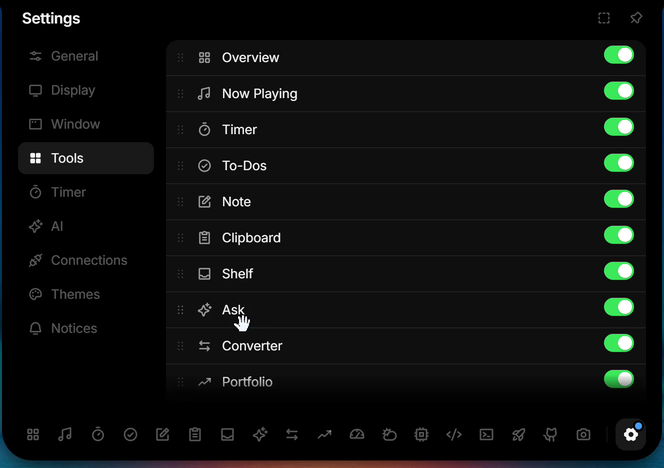

### Setting up the integrations

Every integration is optional. Tools you don't connect simply stay out of your way.

**Ask (AI chat).** Under **AI**, choose a provider (Claude, ChatGPT, OpenRouter or a custom endpoint) and paste your API key. For a custom endpoint, enter the base URL (usually ending in `/v1`) and a model ID. A model that runs on this computer needs no key and no account: start the local server of LM Studio (`http://localhost:1234/v1`) or Ollama (`http://localhost:11434/v1`), choose the custom endpoint, enter that address and the model's ID, and leave the key empty. The reasoning effort is set there too.

**AI usage.** Nothing to enter. If you are signed in to Claude Code, the Codex CLI or Cursor on this device, Crest reads their existing local login and shows your limits. For Antigravity it asks the open Antigravity app over its local connection, or the `agy` CLI when the app is closed, and never touches its login. The ChatGPT card shows your plan's Codex limits: ChatGPT's own chat limits can't be read anywhere.

Claude Code renews its sign-in only while you use it. When that sign-in has expired, Crest on Windows uses the one the Claude desktop app keeps (it renews it by itself while open), so the card stays current as long as you use either. Crest never renews or changes either sign-in. On a Mac, or with neither one signed in, paste your claude.ai session key instead, under **AI** once the Claude card is on: in a browser signed in to claude.ai, open the developer tools, then Application (Storage in Firefox) → Cookies → `https://claude.ai`, and copy the value of `sessionKey`. It gives access to your claude.ai account, so it stays in Credential Manager (the Keychain on a Mac) and is only ever sent to claude.ai. This uses the same page claude.ai shows under Settings → Usage, which is not a documented API and may change.

OpenRouter, DeepSeek and Z.ai need an API key, entered under **AI** once the card is switched on (OpenRouter uses the same key as Ask). Token cost is estimated at the API list price of each model; for models the built-in table does not know, click the cost on the models page and set a price by hand. With a subscription the figure is what the same tokens would cost on the API, not what you pay. After a rate limit (HTTP 429) a source pauses for 2 to 30 minutes, or as long as the service asks, and keeps showing its last reading.

**Portfolio.** Under **Connections** pick the base currency and set up each account with a key that can only read; each provider lists the exact rights to tick (for Trading 212: account data and portfolio; Kraken: Query Funds and Query Ledger Entries; Coinbase: an ECDSA key with View only; Binance: Enable Reading only; Bitpanda: Balances; eToro: a Read key; Interactive Brokers: a Flex Web Service token and an Activity Flex Query with Open Positions and Cash Report). Coins entered by hand are priced by CoinGecko; stocks and ETFs entered by hand use the price you type, since there is no free documented stock quote source. Degiro, Trade Republic and Scalable Capital have no official API and are not supported.

**Discord.** Discord only hands out voice permissions to your own application:

1. Create an application at [discord.com/developers](https://discord.com/developers).
2. Under OAuth2, copy the **Client ID** and **Client Secret** into **Connections**.
3. Under OAuth2, Redirects, add `http://localhost` and save. Without it Discord keeps asking for permission again.
4. Join a call. Discord asks you once to confirm.

**Calendar.** Under **Connections**, add a calendar:

- *ICS link.* Google Calendar: Settings, your calendar, Integrate calendar, **Secret address in iCal format**. Outlook: Settings, Calendar, Shared calendars, **Publish a calendar**, then the ICS link. iCloud: share the calendar as a **Public Calendar** and copy the `webcal://` link. The link is stored in the Credential Manager (the Keychain on a Mac), since anyone with it can read the calendar.
- *CalDAV.* The server (for example `https://caldav.icloud.com`, or your Nextcloud or Fastmail CalDAV address), the user name and an app password (for iCloud: appleid.apple.com, Sign-In and Security, App-Specific Passwords). Crest finds the account's calendars on its own; a calendar's own address works too.

Then switch on the Calendar tool. The notice and the **Next event** part's horizon are set in the same section; the part itself is switched on under **Display**.

**Weather.** Works out of the box with your approximate location (city level, from your IP), looked up at each start while the location is automatic and the weather shows (the Weather tool or Overview). The locate button in the tool looks it up again; pick a city by hand to stop the lookups.

## Install in detail

**Microsoft Store.** [Crest Island](https://apps.microsoft.com/detail/9N2KXJ2924KS) is the Store build: Microsoft signs it and the Store installs its updates, so it has no update check of its own and no portable copy. Start with Windows goes through the package and stays off until you turn it on.

**Installer.**

1. Download `Crest_x.y.z_x64-setup.exe` (on a Windows on ARM PC, `Crest_x.y.z_arm64-setup.exe`) from the [latest release](https://github.com/andrealo20/crest/releases/latest).
2. Run it. No Node, Rust or admin rights needed; it installs for your user only.
3. The notch appears at the top of your screen and starts with Windows from then on.

The installer is not code-signed yet, so Windows SmartScreen may warn on first launch. Click **More info → Run anyway**.

**Portable zip.** Download Crest-x.y.z-Portable-x64.zip (or Crest-x.y.z-Portable-arm64.zip on ARM) instead, unzip it anywhere you can write to and run Crest.exe. Nothing is installed: settings, notes and caches stay in a data folder next to it, crest-notify.exe comes along, and updates replace both in place after checking their signature. Start with Windows is off for a portable copy until you switch it on. API keys stay in the Windows Credential Manager of each PC. Details are in README-portable.txt inside the zip.

**Checksums.** Each release has a `SHA256SUMS` file listing the SHA-256 of every file in it. `sha256sum -c SHA256SUMS --ignore-missing` checks the files you downloaded; in PowerShell, compare `Get-FileHash <file>` with its line.

Crest keeps its settings and data apart from L4-Notchbar, so both can be installed at the same time.

**Requirements.** Windows 11 or Windows 10, 64-bit, on an x64 or ARM64 PC, or macOS 12 or later (preview). Built and tested on Windows 11; Windows 10 should work but is untested. Crest uses WebView2; if it is missing, the installer fetches it automatically.

**Crash log.** If Crest crashes, panics and uncaught interface errors are appended to `crash.log` in `%LOCALAPPDATA%\io.github.andrealo20.crest\logs` (installer), or in `data\logs` next to Crest.exe (portable). Past 512 KB it is renamed to `crash.old.log` and a new one starts. The file stays on your PC; attach it to a bug report if you like.

**What's new.** After an update, a line in the closed notch says what version you are on now; when the check every 4 hours finds a new version (not in the Store build, which the Store updates), the line says it is available. A click opens a page with the changes, a short note on supporting the project with a GitHub Sponsors button, and for a new version an Update now button. The ✕ hides the line for that version, and a fresh install shows nothing.

**Mac.** The `.dmg` is a preview and not notarized: drag Crest to Applications, and if macOS refuses it on first launch, use System Settings → Privacy & Security → Open Anyway. Up to 1.2.1 the app is not signed at all, and macOS calls it damaged instead: run `xattr -dr com.apple.quarantine /Applications/Crest.app` once in Terminal. Keys are in the Keychain and settings in `~/Library/Application Support/io.github.andrealo20.crest`. Shelf, Hardware, Discord, Vault, Terminal, Launcher, Notices, Capture, Recorder and Camera are not there, Find on screen has no shortcut, and the Overview quick controls have no Bluetooth switch. Colour has no screen picker there, since Crest's web view has no eyedropper. The crash log is `crash.log` in `~/Library/Logs/io.github.andrealo20.crest`.

**Copy diagnostics.** Settings, General, Updates has Copy diagnostics, which puts a short plain-text block on the clipboard for a bug report: the app version and build (installer, portable or Store), the Windows edition and build, the app's and the PC's architecture, the number of monitors and their scale, the panel scale, Windows' Text size, the enabled tools, the closed style and edge, and the codes of current errors (update check, GitHub, FPS, Discord). It never includes your user name, the PC's name, file paths, keys, tokens, account names or your location; an error that is not one of Crest's own codes shows as `other`.

## Keys and the vault

- **Keys and secrets** are stored in the Windows Credential Manager (the Keychain on a Mac) under "Crest/…", never in a plain file, and they are never sent back to the interface. On the first start Crest copies keys it finds under "Notch/…" (where older versions and L4-Notchbar keep them). Those originals stay where they are: deleting a key in Crest does not remove them, so remove them in the Credential Manager if you no longer need them.
- **The vault** lives in one file encrypted with Windows DPAPI, readable only under your Windows account. The PIN is checked in the app's backend, not in the interface, and 2FA keys never leave the backend. With Windows Hello turned on, secrets are additionally sealed with AES-256-GCM under a TPM-backed Windows Hello key.

What goes over the network, and when: [PRIVACY.md](../PRIVACY.md).
