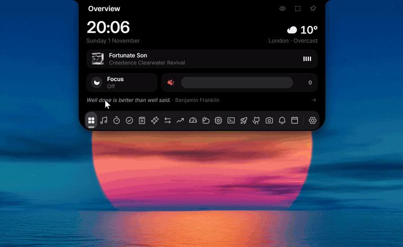

The first public release of Crest: a notch at the edge of your Windows screen with music and synced lyrics, notices, timers and to-dos, screenshots and screen recording, a terminal, an app launcher, your GitHub activity, AI usage limits, live hardware stats, a read-only portfolio across brokers, themes and more.

Every tool, with a picture of each, is in the [README](https://github.com/andrealo20/crest#features). Download the installer below, or the portable zip if you would rather not install anything.
