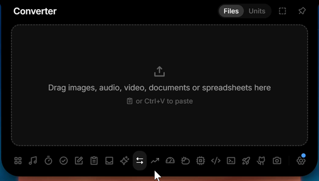

Sizes for the closed notch, a currency converter and a tidier closed row.

- Sizes: Settings → Display → Size sets the width and height of the closed notch and capsule, how far the capsule sits from the edge, and the line's length, thickness and distance. The content grows with the height, and the surface widens by itself when the content needs more room.
- Closed row: each percentage now sits next to its own icon instead of drifting towards the next one. Settings → Tools → Hardware → Coloured icons gives every reading its own colour.
- Converter: Units and Currency. Currency converts between about 30 currencies at the European Central Bank's reference rates, with the date of the rates under the result. File conversion is gone, and files dropped on the notch now go to the Shelf.
- GitHub: your profile picture next to your name, and a click on either opens your profile.
- The installer shows the Crest icon.

