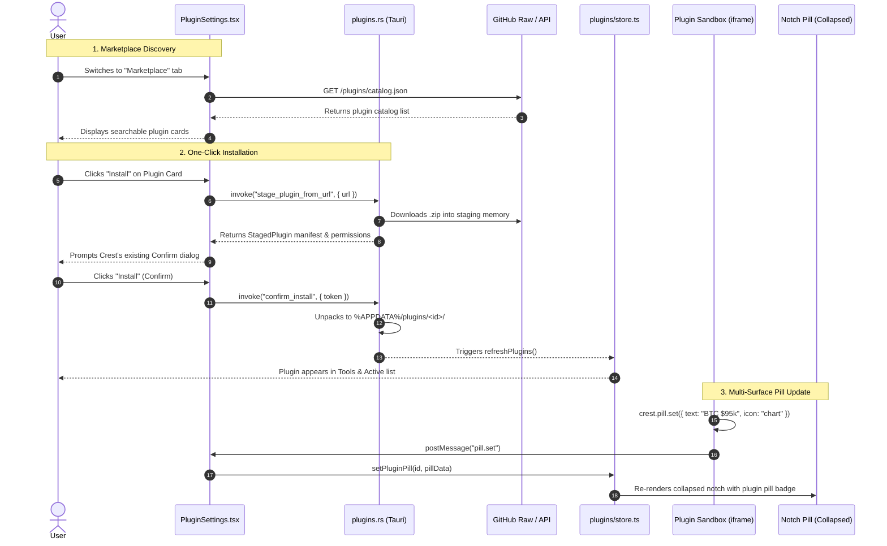

# Design Document: Plugin Marketplace & Multi-Surface Pill API

- **Project**: Crest Dynamic Island
- **Topic**: Community Plugin Marketplace & Multi-Surface Pill API
- **Date**: 2026-11-06
- **Status**: Approved

---

## 1. Context & Motivation

Crest is a lightweight, high-performance desktop Dynamic Island for Windows and macOS built with Tauri v2, React 18, TypeScript, and Motion. It currently features an isolated local plugin engine running in sandboxed iframes over an internal scheme (`crestplugin://` / `http://crestplugin.localhost`).

However, the existing plugin system has two limitations:
1. **Local-Only Distribution**: Users must manually find plugins on the web, download `.zip` files, and use an OS file picker in Settings to install them.
2. **Single-Surface (Panel Only)**: Plugins can only render inside the open drawer tool panel. They cannot surface real-time data (e.g. prices, status, notifications, timers) in the idle/collapsed notch pill.

This feature establishes Crest as a modular desktop platform by introducing:
- A **Community Marketplace** tab directly within Crest Settings for browsing and 1-click installing plugins.
- An in-repo **`plugins/`** directory in `hamsa0x7/crest` containing official and community-contributed plugins with an indexed `catalog.json`.
- A **Multi-Surface Pill API** (`crest.pill.set(...)`) allowing plugins to display live indicators (icon, text, badge, accent color) in the collapsed notch.

---

## 2. Architecture & System Flow



---

## 3. Detailed Specifications

### 3.1 Multi-Surface Pill API

#### Client SDK Extension (`src-tauri/src/plugins/sdk.js`)
Plugins interact with the host via a frozen global `crest` object:
```javascript
crest.pill = Object.freeze({
  /**
   * Set or update the plugin's indicator in the closed notch pill.
   * @param {Object} data
   * @param {string} [data.text] - Short text (up to 16 chars, e.g. "$95.2k", "25:00")
   * @param {string} [data.icon] - Icon name from ICON_NAMES (e.g. "chart", "clock")
   * @param {string} [data.color] - Optional accent color hex (e.g. "#10B981")
   */
  set: (data) => call("pill.set", { data }),

  /**
   * Clears the plugin's pill from the closed notch.
   */
  clear: () => call("pill.clear")
});
```

#### Message Protocol (`src/features/plugins/model.ts`)
Add to `PluginRequest`:
```typescript
export interface PluginPill {
  text?: string;
  icon?: IconName;
  color?: string;
}

export type PluginRequest =
  // ... existing types ...
  | { type: "pill.set"; data: PluginPill }
  | { type: "pill.clear" };
```

#### State Management (`src/features/plugins/store.ts`)
- Maintain an active pill store:
  ```typescript
  export const pluginPills = createStore<Record<string, PluginPill>>({});
  ```
- Handlers:
  - `setPill(id: string, data: PluginPill)`
  - `clearPill(id: string)`
  - When a plugin is toggled off or uninstalled, its pill is automatically purged from the store.

#### Collapsed Notch UI Integration
- In the collapsed notch bar (alongside time and active activities), if any enabled plugin has an active `PluginPill`, render:
  - An icon (using Crest's existing `iconFor(pill.icon)`)
  - A formatted label (`pill.text`) with optional accent coloring.

---

### 3.2 In-App Marketplace

#### Catalog Schema (`plugins/catalog.json`)
The catalog is stored at the root of the `plugins/` directory in the repository:
```json
{
  "version": 1,
  "updatedAt": "2026-11-06T00:00:00Z",
  "plugins": [
    {
      "id": "crypto-ticker",
      "name": "Crypto Ticker",
      "version": "1.0.0",
      "author": "Crest Community",
      "description": "Live cryptocurrency prices in your notch pill and expanded market view.",
      "icon": "chart",
      "downloadUrl": "https://raw.githubusercontent.com/hamsa0x7/crest/main/plugins/crypto-ticker/crypto-ticker.zip",
      "sourceUrl": "https://github.com/hamsa0x7/crest/tree/main/plugins/crypto-ticker",
      "permissions": {
        "network": ["api.coingecko.com"],
        "storage": true,
        "notices": false
      }
    }
  ]
}
```

#### UI Integration (`src/features/plugins/PluginSettings.tsx`)
1. Add a clean segmented switch at the top of the Plugins settings panel:
   ```tsx
   <div className="flex gap-1.5 p-1 bg-fill-2 rounded-lg mb-3">
     <button className={tab === "installed" ? "active" : ""} onClick={() => setTab("installed")}>Installed</button>
     <button className={tab === "marketplace" ? "active" : ""} onClick={() => setTab("marketplace")}>Marketplace</button>
   </div>
   ```
2. In the **Marketplace** view (`MarketplaceView.tsx`):
   - Fetches the raw `catalog.json` from the repository (with a fallback local cache).
   - Renders cards with plugin name, author, icon, short summary, and action button:
     - If not installed: **[Install]** button.
     - If installed & up to date: **[Installed]** badge.
     - If installed & newer version in catalog: **[Update]** button.
   - Clicking **[Install]** calls `stagePluginFromUrl(plugin.downloadUrl)`.
   - Directly reuses Crest's existing `Confirm` dialog to present permissions before writing files.

#### Rust Backend Extension (`src-tauri/src/plugins.rs`)
Add command `stage_plugin_from_url`:
```rust
#[tauri::command]
pub async fn stage_plugin_from_url(app: AppHandle, state: State<'_, PluginsState>, url: String) -> Result<StagedPlugin, String> {
    // 1. Download zip bytes over HTTPS (timeout: 15s, max size: 20MB)
    let bytes = download_bytes(&url).await?;
    // 2. Pass bytes directly to existing verified bundle staging
    stage_zip_bytes(&app, &state, &bytes)
}
```
Reuses 100% of Crest's existing manifest parser, path security sanitizers, and token confirmations.

---

### 3.3 In-Repo `plugins/` Directory Structure

```text
crest/
├── plugins/
│   ├── catalog.json
│   └── crypto-ticker/
│       ├── crest-plugin.json
│       ├── index.html
│       ├── style.css
│       └── app.js
```

#### Starter Plugin: `crypto-ticker`
- **`crest-plugin.json`**:
  ```json
  {
    "id": "crypto-ticker",
    "name": "Crypto Ticker",
    "version": "1.0.0",
    "author": "Crest Team",
    "description": "Live BTC/ETH price in your closed notch with 24h market details.",
    "icon": "chart",
    "entry": "index.html",
    "size": { "w": 460, "h": 260 },
    "permissions": {
      "network": ["api.coingecko.com"],
      "storage": true,
      "notices": false
    }
  }
  ```
- **`app.js`**: Fetches BTC price every 60 seconds and updates:
  ```javascript
  crest.pill.set({ text: `BTC $${price}`, icon: "chart", color: isUp ? "#10B981" : "#EF4444" });
  ```

---

## 4. Blast Radius & Scope Isolation Matrix

| File | Change Type | Purpose |
|---|---|---|
| `src-tauri/src/plugins/sdk.js` | Surgical Edit (+10 lines) | Expose `crest.pill.set()` and `crest.pill.clear()` |
| `src/features/plugins/model.ts` | Surgical Edit (+8 lines) | Add `pill.set` and `pill.clear` types |
| `src/features/plugins/store.ts` | Surgical Edit (+20 lines) | Active pill store & `stagePluginFromUrl` action |
| `src/features/plugins/MarketplaceView.tsx` | New Localized File | Self-contained Marketplace catalog & card browser |
| `src/features/plugins/PluginSettings.tsx` | Surgical Edit (+25 lines) | Segmented control toggle `[Installed] [Marketplace]` |
| `src/features/plugins/PluginView.tsx` | Surgical Edit (+12 lines) | Route `pill.set` and `pill.clear` messages to store |
| `src-tauri/src/plugins.rs` | Surgical Edit (+25 lines) | Add `stage_plugin_from_url` Tauri command |
| `plugins/catalog.json` | New Repo File | Community catalog registry |
| `plugins/crypto-ticker/*` | New Repo Folder | Reference starter plugin |

**Files Outside Scope**:
Untouched: `media/`, `calendar/`, `capture/`, `audio/`, `mixer/`, `terminal/`, `vault/`, `weather/`, `quotes/`, `system/`.

---

## 5. Security & Sandbox Invariants

1. **Unchanged Iframe Sandbox**: All plugin code runs inside `<iframe sandbox="allow-scripts">` served from `http://crestplugin.localhost`.
2. **Explicit Network Whitelisting**: Plugins can only fetch from hostnames explicitly declared in `permissions.network`.
3. **No Local File / Node Access**: Plugins have no access to Tauri APIs, filesystem, child processes, or internal storage outside `%APPDATA%/plugin-data/<id>`.
4. **User Review Gate**: Any plugin installed from the marketplace must be confirmed via Crest's permission review modal before files are placed in the plugins directory.
